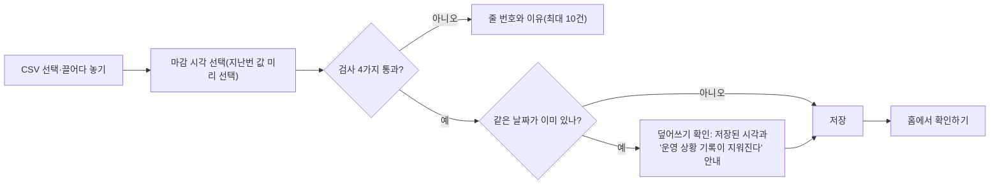

# 01. 로그인과 파일 올리기 (Phase 1~2)

> **지금 상태:** 동작 중. 비밀번호 1개 로그인 + 매출 CSV 올리기(Supabase 저장).
> **관련 문서:** [spec.md](../spec.md) 1~2장, [setup.md](../setup.md) · **코드:** `backend/app/auth.py`, `uploads.py`, `frontend/src/pages/Upload.jsx`, `Login.jsx`
> **커밋:** `0165458` 기획 문서, `779c66d` 1st commit, `d5fe595` 파일 올리기와 Supabase 연결 준비

## 변천 한눈에

| 버전 | 시점 | 방식 | 문제 | 어떻게 고쳤나 |
|---|---|---|---|---|
| v1 초안 | 10-29 | PRD·spec의 설계: 비밀번호 하나(5번 틀리면 10분 잠금, 30일 기억), CSV 올리기, 시각 입력, 검사, 합계 줄 제외, 같은 날짜 덮어쓰기 | 실제 매출 CSV 샘플이 없었음 | 가상 숫자로 만든 시험 파일로 개발하고, 실제 열 모양·인코딩은 미확인으로 남김 |
| v2 | 10-29 | 데이터 보관을 SQLite → Supabase(PostgreSQL) + Alembic | 개발용 SQLite는 실제 서비스(여러 기기)에 맞지 않음 | 설정 값 하나로 전환되는 구조. 접속 정보는 `.env`에만 |
| v3 | 11-03 | 파일 올리기 화면 사용 편의 개선 | 올릴 때마다 시각을 다시 고르고, 올린 뒤 다음 행동이 불분명 | 끌어다 놓기 칸, 지난번 시각 미리 선택, "홈에서 확인하기" 버튼 |

## 1. 초안 (PRD·spec에서 정한 것)

- 점주 1명, 비밀번호 하나. `INITIAL_PASSWORD`로 처음 한 번만 설정. 5번 틀리면 10분 잠금, 한 번 입력하면 30일 유지.
- 비밀번호 없이는 화면도 데이터 주소(API)도 열리지 않는다.
- CSV 올리기: 쉼표·탭·세미콜론 구분, UTF-8과 한글 엑셀(CP949), 2MB 이하, 열 이름만 맞으면 순서 무관, 정수만, 요일은 `수`/`수요일` 모두 허용.
- "몇 시까지 집계한 파일인지"를 24개 시각 중에서 직접 고른다(자정 이후 마감 표현은 아직 없음).
- 잘못된 파일 검사 4가지, "합계" 줄은 제외, 쌓기, 같은 날짜는 덮어쓰기 전에 확인.

## 2. 문제와 수정

### 2-1. 실제 파일이 없었다
- **문제:** 실제 POS가 내보내는 CSV 샘플이 없어서 열 모양과 글자 인코딩이 실제와 같은지 알 수 없었다.
- **조치:** 점주의 `매출_초안.pdf`(23일치)를 날짜별 CSV로 변환해 Supabase에 넣어 확인했다. 변환 CSV와 스크립트는 `.sl-history/`에만 있고 git에는 없다. 저장소·문서·시험에는 실제 매출 숫자를 쓰지 않는다는 원칙을 세웠다.
- **남은 한계:** 지금까지 실제 POS 출력 CSV로는 확인하지 못했다(PDF에서 만든 CSV로만 확인).

### 2-2. SQLite → Supabase
- **문제:** 개발용 SQLite 파일로는 실제로 쓸 수 없다.
- **조치:** 모든 테이블은 Alembic으로만 만들고, 서버는 필요한 테이블이 없으면 **시작을 거부**하고 안내한다(`python -m alembic upgrade head`). 점주가 올린 파일이 Supabase에 정확히 저장된 것(24줄, 합계 일치, 앞자리 0 보존, 합계 줄 제외)을 확인했다.
- **겪은 문제(기록):** Session pooler 주소와 `DB_USER`(`postgres.프로젝트ID`) 형식, `alembic.ini`는 ASCII만 가능(Windows 기본 인코딩) 등 — `check_db.py`가 이유를 알려 준다. `localhost`가 IPv6로 연결되는 문제는 `127.0.0.1`로 해결.
- `backend/sl_dev.db`는 예전 개발용 파일로 지금은 쓰이지 않는다(24줄이 남아 있음. 지우지 않았음).

### 2-3. 시연용 로그인 우회
- 시연 서버(가짜 데이터)에서는 비밀번호 없이 들어가게 `open_login` 설정을 `auth.py`에 두었다. 랩 서버에서만 켜진다([11-demo-lab.md](11-demo-lab.md)).

## 3. 현재 방식

## 4. 남은 일
- 실제 POS CSV 샘플로 열 모양·인코딩 재확인.
- **입출고 파일 올리기 화면은 없다.** 시연 DB에는 도구(`load_stock_csv.py`)로만 넣는다([09-stock-signals.md](09-stock-signals.md)).
- Supabase에는 마이그레이션 0008~0013을 점주가 직접 실행해야 한다(미실행 시 실제 서버가 시작되지 않음).
