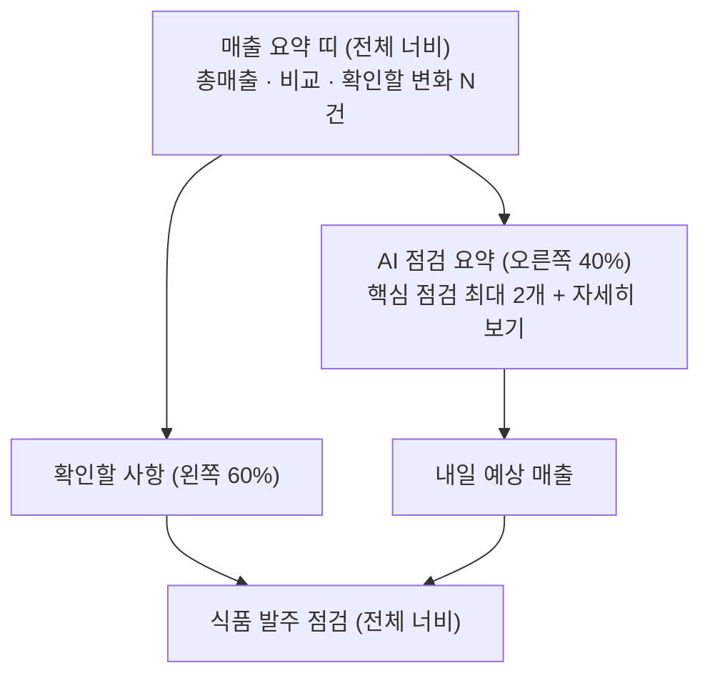

# 02. 홈 화면과 디자인

> **지금 상태:** 밝은 연보라·보라·라임 테마. 컴퓨터는 위쪽 메뉴 + 2단(왼쪽 확인할 사항 60% / 오른쪽 AI 점검 요약·내일 예상 매출 40%) + 아래 전체 너비 식품 발주 점검, 휴대폰은 아래 메뉴 + 한 줄 쌓기.
> **관련 문서:** [design.md](../design.md) · **코드:** `frontend/src/pages/Home.jsx`, `components/Layout.jsx`, `styles.css`
> **커밋:** `5429625`, `c807f4c`, `4455e95`, `f7ba03e`, `316485f`, `7099f92`, `abb4192`

## 변천 한눈에

| 버전 | 시점 | 모습 | 문제 | 고친 방법 |
|---|---|---|---|---|
| v1 | 10-29 (Phase 3) | 어두운 네이비 카드형(배경 `#0C1019`), 앰버 포인트, Pretendard. 카드: 오늘 총매출·판매수량 / 같은 요일 비교 / 즉석식품 요약 / "준비 중" 카드 | — | — |
| v2 | 10-29 | 홈을 세 영역으로: 매출 요약 · 확인할 사항 · 집중 관리 식품군. 용어 정리("이상한 날"→"판매 변화가 큰 날") | 기록된 규칙: 상단과 같은 숫자를 다시 보여 주는 카드, 항목마다 반복되는 버튼·배지는 두지 않는다 | 확인할 사항은 한 줄 전체가 링크, 기록 버튼은 상세 화면에만. 준비 중 카드는 숨김 |
| v3 | 11-03 오전 | 맨 위 요약 띠 + 1024px 이상 2단 배치 + 위쪽 메뉴, **밝은 연보라 테마** | 기록된 이유: 편의점 간판 느낌, 점주가 읽기 편한 차분한 업무 화면 | 경고색을 주황으로 분리, 라임은 주요 버튼·활성 메뉴 막대에만 |
| v4 | 11-03 낮 | 홈 60/40 배치, `AI 점검 요약`(번호 제안 2~3개), 설정 4묶음 | 카드 길이가 달라 생기는 빈 공간을 억지로 채우지 않기로 함(기록된 규칙) | 간격 24px 통일. 카드 높이 고정·min-height·음수 마진·카드 안 스크롤 금지 |
| v5 | 11-03 오후 | 위 두 칸 아래에 **식품 발주 점검**을 전체 너비로. 집중 관리 식품군 표는 없앰 | 컴퓨터/휴대폰에서 읽는 순서가 다른데 CSS로 순서를 바꾸면 Tab 이동 순서가 눈에 보이는 순서와 달라짐 | 화면 폭(1024px)에 따라 카드를 **그리는 순서 자체**를 바꿈(`useWide`) |
| v6 | 11-04 | 홈 AI 카드는 짧게, 상세는 오른쪽 패널 | AI 요약이 길어지면 오른쪽 열이 늘어 아래 카드를 밀고 왼쪽에 큰 빈 공간 | → [08-ai-summary.md](08-ai-summary.md) |

## 1. 초안 (v1)

- 기획(PRD): 점주가 아침에 열면 오늘 총매출, 평소와의 차이, 즉석식품 현황을 한눈에. 모든 카드에 "몇 시까지" 시각 표시.
- 디자인 규칙: 장식용 그라데이션·그림자 제거, 선형 아이콘, 키보드 포커스 표시. 증감 색(민트·코랄)은 **매출 변화 방향에만** 쓰고 정상·주의와 구분.
- 홈 매출 요약 기준: **같은 요일·같은 시각까지 최근 4번의 평균**, 3번 이상 쌓여야 비교 표시(모자라면 "데이터가 더 필요해요 1/3").

## 2. 문제와 수정

### 2-1. 어두운 테마 → 밝은 연보라 테마 (11-03)
- 기록에 남은 이유는 "편의점 간판 느낌의 밝은 보라, 점주가 읽기 편한 차분한 업무 화면"뿐이다. 어두운 테마의 구체적인 불만은 기록에 없다.
- 보라(메뉴·링크·AI 강조), 라임(주요 버튼)을 유지하고 앰버 경고색은 주황으로 바꿔 라임과 겹치지 않게 했다.
- 편의점 그림과 마스코트는 **상표·로고 없이** 둥근 도형으로 직접 그렸다. 하단 메뉴를 카드가 가리던 문제는 z-index로 수정. 큰 화면 폭은 1480px까지 넓혔다가 이후 점주 요청으로 콘텐츠 폭을 1,160~1,200px, 본문 16px·보조 14px로 정리했다.

### 2-2. 홈 요약 기준이 두 개
- **문제:** 홈 매출 요약(같은 요일 최근 4번 평균)과 총매출 분석(요일 구분 없이 전체 분포)의 기준이 달라 금액이 다르게 보인다.
- **조치:** 화면에 두 기준의 차이를 밝혔다. **통일은 하지 않았다**(통일하려면 홈 계산을 바꿔야 함 → [04-sales-analysis.md](04-sales-analysis.md)).

### 2-3. 읽는 순서 vs Tab 순서
- **문제:** 컴퓨터는 `확인할 사항 → AI 요약 → 예상 매출 → 식품 발주 점검`, 휴대폰은 `확인할 사항 → 식품 발주 점검 → AI 요약 → 예상 매출`. CSS `order`로 바꾸면 눈에 보이는 순서와 키보드 순서가 어긋난다.
- **조치:** `useWide()`(matchMedia 1024px)로 화면 폭에 따라 카드를 그리는 순서를 직접 바꿨다.

### 2-4. AI 카드가 길어져 레이아웃이 밀림 (11-04)
- 상세는 [08-ai-summary.md](08-ai-summary.md). 홈에는 짧은 요약만 두고 상세는 고정 위치 패널로 보내 배경 카드 배치를 바꾸지 않게 했다.

## 3. 현재 구조

휴대폰: 확인할 사항 → 식품 발주 점검 → AI 점검 요약 → 내일 예상 매출.

## 4. 남은 일·한계
- 홈 API가 화면에서 쓰이지 않던 `instant_food`(간편식사·즉석조리 즉석식품 요약) 값을 계산해 돌려주던 것은 2026-11-04에 지웠다(시험 포함).
- 실제 휴대폰 기기로 확인한 것이 아니라 브라우저의 좁은 화면(390px)으로 확인했다.
