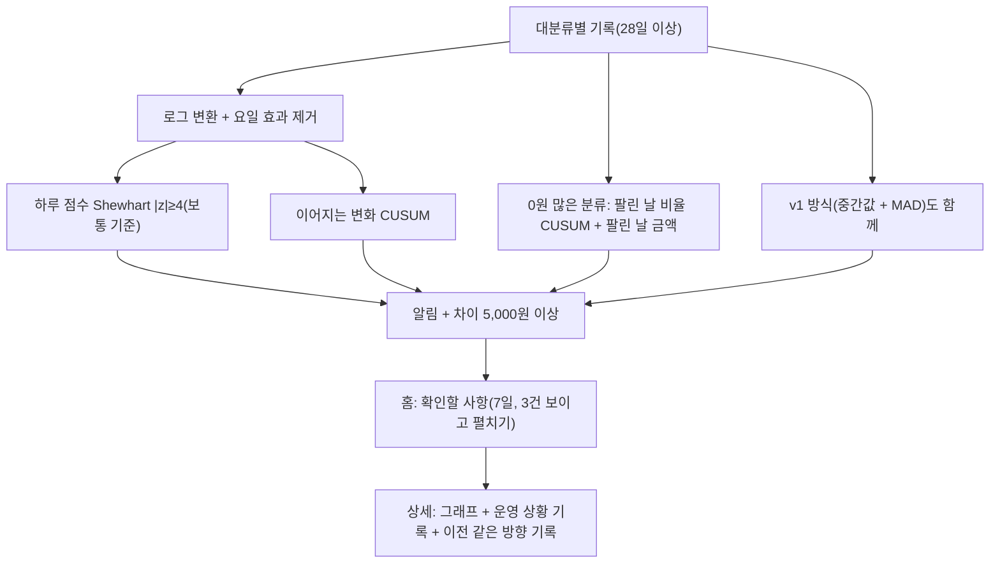

# 03. 확인할 사항 (평소와 다른 분류 찾기) 과 운영 상황 기록

> **지금 상태:** 동작 중. 분류별로 하루 비교 + 이어지는 변화(CUSUM) + 0원이 많은 분류 방식을 함께 쓰고, 알림 민감도(큰 변화 위주 / 균형 있게 / 작은 변화까지)를 고른다. 장날·공휴일·방학은 알림을 빼지 않고 "참고" 한 줄만 붙인다.
> **관련 문서:** [calculation.md](../calculation.md), [stats-guide.md](../stats-guide.md) 1장, [lab.md](../lab.md), [spec.md](../spec.md) 3장 · **코드:** `backend/app/anomalies.py`, `detection.py`
> **커밋:** `4455e95`(Phase 4), `79e3baa`(탐지 개선·민감도), `ba67022`(참고 한 줄)

## 변천 한눈에

| 버전 | 시점 | 방식 | 문제 | 고친 방법 |
|---|---|---|---|---|
| v1 | 10-29 | 대분류마다 자기 평소(같은 요일·같은 시각까지 기록 전부)와 비교. **중간값 + MAD 점수 ≥ 3, 차이 ≥ 5,000원**, 최소 3번 | ① 금액 그대로라 급감·품절이 점수에 작게 나옴 ② 매일 조금씩 줄어드는 변화는 하루씩은 평범해 못 잡음 ③ 거의 늘 0원인 분류의 안 팔림을 구분 못 함 | v2 |
| v2 | 11-02 | v1에 **로그 변환 + 요일 효과 제거 + Shewhart(|z|≥4) + CUSUM**, 0원이 많은 분류 전용(팔린 날 비율 CUSUM + 팔린 날 금액), 거의 안 팔리는 분류("평소보다 많이 팔릴 때만"). 기록 28일 이상일 때 동작. 민감도 3단계 | — | 알림 오경보 수는 가짜 자료로만 측정(아래 한계) |
| 용어 | 10-29 | "이상한 날" → **판매 변화가 큰 날**, "확인함·정상" → **운영 상황 기록** | "정상"이라고 눌러 두면 정상 판정처럼 읽힘 | "점주가 확인해 특이사항 없음으로 답함"으로 정의, 정상·문제없음 표현 금지 |
| 참고 | 11-02 | 장날·공휴일·방학이면 알림 아래 "참고: 이날은 공휴일(설날)이에요. 평소와 다를 수 있어요." | 휴일이라고 알림을 빼면 진짜 문제를 놓칠 수 있음 | 알림은 그대로, 설명만 붙임 |

## 1. 초안 (v1)

- **판단 대상:** 대분류의 하루 매출금액.
- **평소:** 그날보다 앞선 같은 요일, 같은 시각까지 집계한 기록 **전부**(최근 4번으로 자르지 않음). 마감 시각이 다른 날은 평소에서 뺀다.
- **점수:** (그날 금액 − 평소 중간값) ÷ 흩어진 정도(MAD). 점수 3 이상 + 차이 5,000원 이상이면 이상한 날. 흩어진 정도에 하한을 둬 점수 폭발을 막는다.
- **거의 늘 0원인 분류**(복권 등)는 안 팔린 날을 이상으로 보지 않고 팔린 날끼리만 비교, 한 번도 안 팔리던 분류는 20,000원 이상일 때만 올린다.
- 홈 목록은 가장 최근 올린 날짜로부터 7일 안, 아직 기록 안 한 것만. 목록은 대분류 단위, 확인은 날짜 단위.
- 점주와 정한 것: 민감도 "보통", 최소 데이터 같은 요일 3번.
- 가상 데이터 시뮬레이션: 정상인데 뜨는 경고 하루 약 1건, 평소의 2.5배 급증은 거의 100%.

## 2. 문제 발견

### 2-1. 급감·품절을 못 잡는다 (가짜 자료 평가)
실제 자료는 월·화·수 23일뿐이라, 실제 분포를 흉내 낸 가짜 자료 301일에 **정답이 표시된 이상**(급증 2.5~4.5배, 급감 0.1~0.4배, 품절 0원)을 넣어 평가 도구(`eval_detection.py`)로 측정했다.

| 방식 | 재현율 | 급증 | 급감 | 품절 | 오경보(하루) |
|---|---|---|---|---|---|
| v1 (급증 3.0 / 급감 3.0) | 51% | 82/99 | 7/64 | 1/14 | 0.45건 |
| 혼합: 급감만 로그 2.5 | 73% | 82/99 | 34/64 | 13/14 | 0.64건 |
| 혼합: 급증 2.5, 급감 로그 2.0 | 81% | 88/99 | 42/64 | 13/14 | 0.84건 |

- 이유(로그의 효과): 9만 → 27만(3배)과 9만 → 3만(1/3)은 로그로 보면 크기가 같고 방향만 반대다. 금액 그대로는 +18만과 −6만이라 급감이 작아 보인다.
- 이어지는 변화(3주째 평소의 55%)는 하루 점수로 안 잡히므로 누적(CUSUM)이 맡고, Shewhart는 분명한 큰 변화만 알리도록 기준을 4로 높였다("통계로 정해진 값이 아니라 오경보를 줄이려는 선택").

### 2-2. "정상" 표현
- 점주가 "확인함·정상"을 누르면 정상 판정처럼 읽히는 문제 → "운영 상황 기록"(행사·진열 변경 / 단체 구매 / 입고·품절 / 데이터 확인 필요 / 기타 / 모르겠어요 / 특이사항 없음 + 메모). 같은 날짜 파일을 덮어쓰면 기록 초기화.

### 2-3. 휴일을 알림에서 빼는 안
- 기록에 남은 판단: 공휴일·장날·방학이라고 알림을 빼면 진짜 문제를 놓칠 수 있어 **참고 한 줄만** 붙인다. 코드에 박혀 있던 장날(3·8일)은 없애고 점주가 저장한 장날만 쓴다.

## 3. 현재 방식(요약)

## 4. 한계·남은 일
- 기준값은 초기값이다(`anomalies.py`·`detection.py` 맨 위). 실제 자료가 쌓이면 조정해야 한다.
- 정상 날의 오경보 비율은 가짜 자료에서 보수적으로 나왔다(이론 5% 근처인데 1.9%) → 오경보는 적지만 진짜 변화를 덜 잡을 수도 있다. **실제 알림 오경보 측정은 아직 하지 않았다.**
- 날짜 수가 늘면 확인할 사항 계산이 제곱으로 느려진다(301일에 0.4초). 3년치쯤에서 고쳐야 한다.
- 반년쯤 쌓이면 옛 기록이 평소를 왜곡할 수 있다(상권·메뉴 변화).
- "이전 기록 찾기"(같은 방향 변화에서 점주가 남긴 기록 최대 3건, AI 없음)는 유지하고, "도움이 됐어요" 평가는 2026-11-02에 없앴다.
