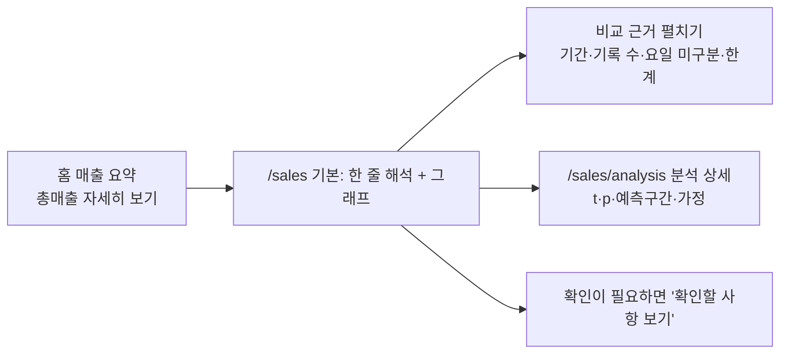

# 04. 총매출 분석

> **지금 상태:** 동작 중. 홈 매출 요약의 상세 화면(`/sales`, `/sales/analysis`). 같은 시각까지 집계한 이전 모든 날(요일 구분 없음)의 분포에서 오늘 값이 어디인지 t 예측구간 검정으로 판단.
> **관련 문서:** [spec.md](../spec.md) 4장·Phase 4 세부, [stats-guide.md](../stats-guide.md) · **코드:** `backend/app/sales_detail.py`, `stats.py`, `frontend/src/pages/SalesDetail.jsx`, `SalesAnalysis.jsx`, `components/SalesChart.jsx`
> **커밋:** `4455e95`

## 변천 한눈에

| 버전 | 방식 | 문제 | 고친 방법 |
|---|---|---|---|
| v1 | 시간대까지의 날짜별 총매출 시계열 + 통계 판단을 한 화면에 모두 보여 줌 | 통계를 모르는 점주에게 용어(유의미, 95% 범위, p값 등)가 많음 | **세 단계 화면**: ① 기본(오늘 매출·금액 차이·쉬운 한 줄 해석·그래프) ② "어떤 기록과 비교했나요?" ③ 분석 상세 |
| 기준 | 요일 구분 없이 전체 분포 | 홈 매출 요약(같은 요일 최근 4번 평균)과 금액이 다르게 보임 | 화면에 기준 차이를 밝힘(통일은 미해결) |

## 1. 초안과 점주와 정한 방식

- 점주 요청: 같은 요일끼리 나누지 말고, **쌓인 기록 전체의 분포**에서 오늘이 어디쯤인지 보여 달라.
- 분포: 매출은 몇 %씩 흔들리므로 **비율(로그) 기준 정규분포**. 평소 범위가 0원 아래로 내려가지 않는다. 0원이 있으면 금액 그대로 계산.
- 판정: Student t **예측구간 검정**(양쪽, 5%). t = (오늘 − 평균) ÷ (표준편차 × √(1 + 1/n)), 자유도 n − 1. 3번 미만이면 "판단 자료 부족".
- t 분포는 외부 라이브러리 없이 직접 계산하고 표준표(자유도 1~30)와 일치하는지 시험한다.

## 2. 문제와 수정

1. **용어 과다.** 기본 화면에서 "통계적으로 유의미한", 중심값, 95% 범위 수치, 상위 %, p값을 모두 분석 상세로 옮기고, 해석은 실제 탐지 결과에서 나오는 한 줄로 바꿨다("매출은 늘었지만, 평소 변동 범위를 크게 벗어나지는 않았어요" 등).
2. **판정처럼 읽힘.** "문제없음", "정상 영업", 원인 확정 표현을 쓰지 않는다. 결과를 쓸 수 없는 조건(자료 부족, 변동 없음)은 접지 않고 기본 화면에 표시, 기록이 5번 미만이면 "참고용".
3. **그래프 규칙.** 처음부터 차트 라이브러리 없이 **직접 만든 SVG**를 화면 폭 그대로(1단위 = 1px) 그려, 점주가 정한 두께(판매선 1.5px, 기준선 1px 점선)가 실제 CSS px로 적용되게 했다(기록된 이유: 라이브러리 기본 스타일이 덮어쓰지 않도록). 파일을 올리지 않은 날(미수집)은 0원으로 채우지 않고 선을 잇지도 않는다. 선택한 점의 금액 라벨은 선·점·경계와 겹치지 않는 자리로 옮긴다.
4. **비교 기준 혼동.** 홈은 "같은 수요일 기준(최근 4번 평균)", 이 화면은 "이전 기록의 비교 기준(요일 구분 없는 전체)". 이름과 계산이 다르다는 점을 화면에 적었다.

## 3. 현재 구성

## 4. 한계
- 연휴·행사가 섞인 날이 평소에 들어가 범위가 넓어질 수 있다. 요일 차이도 평소 흔들림에 들어간다.
- 홈과 이 화면의 기준이 다르다는 점은 해소되지 않았다.
