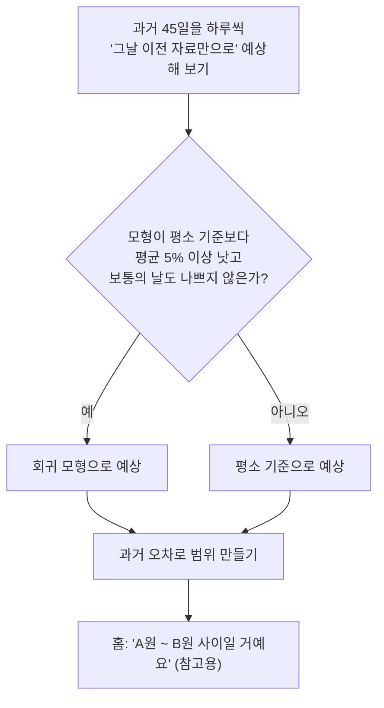

# 05. 내일 예상 매출

> **지금 상태:** 동작 중(첫 버전). 홈 "내일 아침 예상 매출" 카드에 **"A원 ~ B원 사이"** 범위만 보여 준다. 날씨·장날·공휴일·방학을 넣은 릿지 회귀 모형이 **평소 기준보다 낫다고 확인될 때만** 쓰이고, 아니면 평소 기준(같은 요일 중간값 또는 최근 중간값)을 쓴다.
> **관련 문서:** [forecast-considerations.md](../forecast-considerations.md), [stats-guide.md](../stats-guide.md) 3장, [spec.md](../spec.md) 6장 · **코드:** `backend/app/forecast.py`, `weather.py`, `asos_stations.py`
> **커밋:** `a2567d9`(모형·날씨 저장), `fd8b376`(전국 관측소)

## 변천 한눈에

| 버전 | 시점 | 방식 | 문제 | 고친 방법 |
|---|---|---|---|---|
| 계획 | PRD / plan Phase 7 | 장날·공휴일·날씨·방학을 넣은 회귀 모형, 범위와 가운데 값, "참고용" 표시, 실패 시 빠진 정보 표시 | 실제 자료가 월·화·수 23일뿐이라 날씨 효과를 믿을 수 없음 | "평소 기준보다 나을 때만 모형을 쓴다"는 안전장치 |
| v1 | 11-02 | 릿지 회귀(L2) + 걸러서 맞혀 보기(과거 45일을 하루씩 그날 이전 자료만으로 예상) + 최근 14일 오차의 절반만큼 보정 | 점주 요청: 계산 과정이 아니라 **범위만** 보여 달라 | 화면에는 "A원 ~ B원"만, 근거는 문서에만 |
| 관측소 | 11-03 | 과거 날씨 관측소 수도권 8곳 → **전국 ASOS 97곳** + 50km 안전장치 | 충남 보령은 122km 떨어진 수원 날씨를 쓰고 있었음 | 가장 가까운 관측소가 50km보다 멀면 날씨를 가져오지 않고 "관측소가 멀어요" 표시 |

## 1. 초안

내일 매출은 요일·장날·공휴일·방학·기온·비에 따라 달라진다. 과거에서 "각 요인이 매출을 몇 % 바꾸나"를 회귀로 찾는다.

```
로그(하루 매출) = 기본값 + 요일 효과 + 장날 + 공휴일 + 방학 + 기온 효과 + 비 온 날 + 남는 차이
```

## 2. 문제와 수정

### 2-1. "정말 나은가?"를 어떻게 알까
- **문제:** 자료가 적으면 우연한 흔들림을 효과로 외운다(비 온 날이 2번뿐인데 우연히 바빴다고 "비가 오면 매출 증가"라고 믿기).
- **조치 3가지:** ① 규제(릿지)로 효과의 크기에 벌금을 매긴다. ② 최근 14일 오차의 절반만큼 예상을 옮겨 매출 수준이 서서히 변하는 것을 따라간다. ③ 걸러서 맞혀 보기(백테스트)로 평소 기준보다 평균 5% 이상 낫고 보통의 날도 나쁘지 않을 때만 모형을 쓴다.
- **결과:** 실제 23일 자료에서는 평소 기준이 쓰이고(목요일 이후는 본 적도 없음), 가짜 시연 자료(301일)에서는 모형이 쓰인다.

### 2-2. 다른 모형도 써 봤다 (같은 조건 11종 비교, 가짜 자료 3개)
- 부스팅·랜덤 포레스트·ARIMAX 등 **복잡한 모형이 이기지 못했다.** 하루 흔들림이 약 25%라 줄일 수 있는 오차가 거의 없다.
- 개선의 대부분은 날씨가 아니라 **보정**에서 나왔다(보정 약 7%p, 날씨 약 2.6%p).
- 라쏘(L1)도 시험했는데 성능이 같았고(28.7%) 변수를 0으로 지워 "효과 없음"으로 오해하기 쉬워 **릿지(L2)를 유지**했다. 방학·기온·연휴는 겨울에 같이 움직여 L1은 아무거나 하나를 고르는 불안정이 있다.
- 한계: 가짜 자료가 선형으로 만들어져 선형 모형에 유리하다. 실제 자료가 쌓이면 다시 비교해야 한다.

### 2-3. 기상특보는 넣지 않음
- 폭염·폭설·태풍 특보는 과거를 조회할 수 없어(최근 6일뿐) 학습할 수 없고 효과를 아는 자료도 없다. 앱에 넣지 않고 고려사항으로만 기록(몇 달 뒤 매일 저장하면 변수 후보).

### 2-4. 관측소가 수도권 8곳뿐
- 전국 ASOS 97곳을 공식 API로 번호·이름, 카카오로 좌표를 확인해 넣었다. 50km 기준은 제 판단이다. 점포 위치를 바꾸면 이미 저장된 날씨가 옛 관측소 것으로 남는 문제는 11-03 오후 "위치 변경 시 정리"로 이어서 해결됐다([06-settings-autofill.md](06-settings-autofill.md)).

### 2-5. 탐색 중 실수 (정정)
- 모형 탐색용 분석 스크립트가 CSV의 "합계" 줄을 하루 매출에 한 번 더 더해 **하루 매출 금액이 2배로 계산**됐다. 앱 코드는 합계 줄을 이미 올바르게 빼고 있었고(스크립트의 실수), 비율로 낸 결과는 그대로이며 금액만 정정했다. 교훈: 숫자가 이상하면 먼저 의심하기.

## 3. 현재 흐름



## 4. 한계 (정직하게)
- **시연 자료에서 모형이 잘 맞는 것은 코드가 맞게 동작한다는 확인이지, 날씨가 매출을 이만큼 바꾼다는 증거가 아니다.** 날씨 효과(기온 1도당 +0.6%, 비 온 날 −8%)는 내가 정해서 심은 가정값이다.
- 보정값(14일·절반)은 시연 자료 하나로 골랐고, 범위에 실제가 들어온 비율이 77%로 목표(80%)보다 약간 낮다.
- 시연 자료에는 공휴일·방학 효과가 아직 없다(개발 후보).
- 점포 위치가 관측소에서 50km 넘으면 날씨 없이 예상한다. 50km는 판단값.
