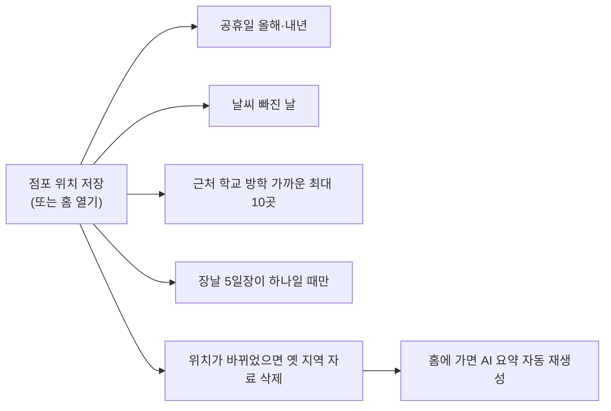

# 06. 설정과 "위치만 정하면 나머지는 자동"

> **지금 상태:** 동작 중. 점포 위치(주소)만 정하면 공휴일·날씨·근처 학교 방학·장날을 자동으로 채우고, 위치가 바뀌면 옛 지역 자료를 지운 뒤 새로 채우며 홈의 AI 요약도 다시 만든다. 설정은 4묶음(점포 정보 · 분석 데이터 · 알림 설정 · 계정·보안).
> **관련 문서:** [spec.md](../spec.md) 7장, [lab.md](../lab.md), [plan.md](../plan.md) · **코드:** `backend/app/autosync.py`, `schools.py`, `markets.py`, `holidays.py`, `weather.py`, `address.py`, `settings_page.py`, `frontend/src/pages/Settings.jsx`, `Setup.jsx`
> **커밋:** `4e64736`, `634857a`, `ba67022`, `b529c2a`, `afd5e89`, `fd8b376`, `7099f92`

## 변천 한눈에

| 버전 | 시점 | 방식 | 문제 | 고친 방법 |
|---|---|---|---|---|
| v1 계획 | plan 6-1 | 점포 위치(시·동) 입력, 방학 기간과 장날 규칙을 **직접 입력·수정·삭제**, 비밀번호 바꾸기 | 기록에 이유가 남아 있지 않음(plan 6-2에서 공식 자료를 가져오는 방식이 추가됨) | v2 |
| v2 | 11-02 | 위치는 **주소 검색(카카오)**, 방학은 근처 500m 학교를 NEIS 학사일정에서 추정해 점주가 **고른 것만 저장**, 장날은 근처 5일장을 점주가 고른 것, 공휴일은 확인 후 저장 | 점주 지적: 공휴일처럼 안 변하는 것까지 일일이 가져와 확인하게 할 필요가 없다 | v3 |
| v3 | 11-03 | 위치를 저장하면 **자동으로 채움**(학교는 가까운 최대 10곳 전부, 장날은 5일장이 하나일 때만, 공휴일 올해·내년, 빠진 날씨) | 위치를 바꿔도 옛 지역의 방학·장날·날씨가 그대로 남음 | 위치가 바뀌면 옛 지역 공식 자료 삭제(직접 입력한 방학은 보존) + 새로 채움 + AI 요약 재생성 |
| 설정 구조 | 11-03 | 카드 여러 개 → **4묶음** + "설정이 필요한 항목 N개" 요약 | 점주 요청(설정 화면 재구성). 구체적인 불편은 기록에 남아 있지 않음 | 왼쪽 메뉴 + 오른쪽 한 묶음 |

## 1. 초안 → v2

- 위도·경도를 점주가 직접 입력하는 안(지도 앱에서 복사)이 처음 계획이었고, 도로명주소 API는 기관·업체 등록이 필요해 쓰지 않았다. v2에서 **카카오 로컬 주소 검색**으로 바뀌었고 위도·경도 직접 입력은 예비(접힘)로 남았다.
- 방학: 반경 500m 학교(전국초중등학교위치표준데이터) → 점주가 학교 선택 → NEIS 학사일정에서 `방학식`~`개학식` 행사명 규칙으로 추정 → 점주가 확인한 것만 저장(출처 "공식"). 추정이 안 되는 학교·대학은 직접 입력.
- 장날: 반경 500m 전통시장 → 5일장 날짜(예: 3·8일장 → 3·8·13·18·23·28일). 상설시장은 안내만.
- 공휴일: 한국천문연구원 특일 정보로 올해·내년(대체공휴일 포함), 점주가 확인한 뒤 저장.

## 2. 문제 발견과 수정

### 2-1. 전남 학교 1,135곳의 방학을 못 가져옴 (11-02)
- **증상:** 순천 고등학교의 방학을 못 가져옴.
- **원인:** 공공데이터의 교육청 이름이 "전남광주통합특별시교육청"으로 바뀌어, 이름에 "광주"가 있다고 광주 교육청에서만 찾았다. 한 학교 문제가 **한 지역 전체**의 문제였다.
- **해결:** 합쳐진 이름은 전남·광주를 차례로 찾고, 못 찾으면 교육청 없이 **도로명주소**로 찾는다.

### 2-2. 전국 점검 (11-02)
한 학교만 고치고 끝내지 않고 전국 학교 12,004곳을 NEIS 전체 목록과 앱의 연결 함수로 맞춰 봤다.

| 단계 | 못 찾는 학교 |
|---|---|
| 점검 전 | 1,177곳 |
| 1차 개선(교육청명 합침) | 42곳 |
| 2차 개선(주소 표기 차이) | **12곳** (연결률 99.90%) |

- 2차 개선: 화성시 **만세구** ↔ 화성시, 부천시 **원미구** ↔ 부천시, 강원**특별자치도** ↔ 강원도, "84" ↔ "84번지"를 다루고 **도로 이름 + 건물 번호**로도 알아본다. 같은 건물이 둘이면 **고르지 않는다**(잘못 연결하는 것보다 못 찾는 편이 안전).
- 남은 12곳은 NEIS에 이름이 없는 학교(제주 외국인학교 7곳, 방송통신고 등). 방학 추정까지 무작위 144곳을 실제 NEIS로 끝까지 시험해 143곳 성공. 점검 도구 `tools/audit_schools.py`를 남겼다.

### 2-3. 시연 DB의 장날이 사실처럼 쓰임 (11-02)
- **증상:** 근처에 시장이 없는데 AI가 "내일 장날"을 제안.
- **원인:** 시연 DB에 미리 넣어 둔 장날(3·8일)이 사실처럼 쓰였다.
- **해결:** 시연 DB가 장날을 미리 저장하지 않게 하고, 근처 시장이 없을 때 저장된 장날을 지울 수 있게 했다. 교훈: 시연용 값이 실제 앱 동작에 섞이면 안 된다.

### 2-4. 점주가 학교·시장을 고르던 단계가 없어짐 (11-03, 점주 요청)
- 점주 요청: "공휴일을 굳이 가져와야 할까? 어차피 안 변하니 자동으로" → "위치 변경 시 자동으로 정리되게 하고, 자동으로 정리될 수 있다면 설정창에서 굳이 설정을 안 해도 될 것 같아".
- **제가 정한 기준(검증 전):** 학교는 반경 안 가까운 최대 10곳 **전부**, 장날은 5일장이 딱 하나일 때만 자동. 점주가 학교를 고르던 단계가 없어졌다.

### 2-5. 위치를 바꿔도 옛 지역 자료가 남음 (11-03)
- `autosync.reset_region`: 위치가 바뀌면 옛 지역의 공식 방학·장날과 **다른 관측소의 날씨**를 지우고 새 위치로 다시 채운다. **점주가 직접 입력한 방학은 지우지 않고**, 같은 위치를 다시 저장하면 아무것도 지우지 않는다. 키가 없거나 연결이 안 돼도 홈과 저장은 그대로 동작하고 그 항목만 `확인 필요`로 보인다.
- 시연 서버에서 보령→시흥→보령으로 옮겨 실제로 확인(시흥장현초 방학이 자동으로 들어오고, 보령으로 돌아오면 비워짐).
- **위치를 바꿔도 AI 요약이 안 갱신되던 문제**: 위치 저장 시 기억해 둔 요약을 지우고 표시를 남겨, 홈에 가면 한 번 자동으로 새로 만든다(→ [08-ai-summary.md](08-ai-summary.md)).

### 2-6. 날씨 관측소 (→ [05-forecast.md](05-forecast.md))
- 수도권 8곳 → 전국 97곳, 50km 넘으면 쓰지 않음. 상가정보 API가 반경에 상가가 없을 때 주는 NODATA(03)는 실패가 아니라 0곳으로 처리.

### 2-7. "주소 변경" 칸의 정체
- 처음에는 지역을 바꿔 가며 시험하려고 설정 맨 위에 **임시 칸**("점포 위치 다시 고르기(시험용)")으로 넣었고 출시 전 삭제 예정이었다(`4a267b0`). 설정 재구성(11-03)에서 `점포 정보 → 주소 변경`이라는 정식 칸이 되었다. **지울지는 출시 전에 정하기로 하고 plan.md에 기록돼 있다.**

## 3. 현재 흐름

## 4. 한계·남은 일
- 수능 날짜(`events.py`)는 기억에 의한 값이라 교육부 발표와 대조해야 한다.
- 대학 방학은 어림이다(학교마다 다름). 관측소가 새로 생기거나 없어지면 목록을 다시 확인해야 한다.
- 장날을 자동으로 정하는 기준(5일장 하나일 때만)과 학교 최대 10곳은 제 판단이다.
