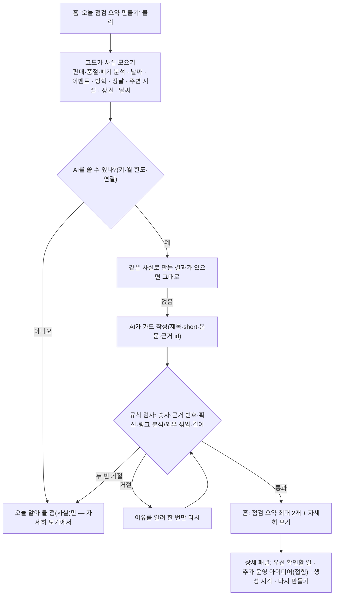

# 08. AI 점검 → AI 제안 → AI 점검 요약 (홈 카드와 상세 패널)

> **지금 상태:** 홈 "AI 점검 요약" 카드는 핵심 점검 최대 2개(제목 + 한 문장)만 보이고, "점검 내용 자세히 보기"로 여는 상세 패널에 우선 확인할 일·추가 운영 아이디어(접힘)·생성 시각·다시 만들기가 있다. 누를 때만 AI를 부르고, 사실은 코드가 모으고 AI는 문장만 쓴다.
> **관련 문서:** [suggestions.md](../suggestions.md), [design.md](../design.md) "AI 점검 요약 카드", [spec.md](../spec.md) "AI 제안", [sdd-ai.md](../sdd-ai.md)(초안, 현재 구현 아님) · **코드:** `backend/app/suggestions.py`, `ai/`, `frontend/src/components/SuggestCard.jsx`, `stockText.jsx`
> **커밋:** `79e3baa`(Phase 5) → `afd5e89`(교체) → `4a267b0` → `7099f92` → `abb4192` → `2881c9c` 및 이후 작업

## 변천 한눈에

| 버전 | 시점 | 모양·방식 | 문제 | 고친 방법 |
|---|---|---|---|---|
| v0 | 10-29~11-02 | **Phase 5 AI 점검**: 홈 "오늘의 점검"(변화 1~2개를 숫자 근거→확인 질문→확인할 일로), "한마디 운영 메모"(글을 분류·날짜·시각 초안으로 정리), 이전 기록·"도움이 됐어요" 평가, 설정의 AI 상태 카드 | 점검 카드와 "확인할 사항"이 같은 변화를 두 번 보여 줌, 가드가 고정 문구로 자주 떨어질 수 있음, 한마디 메모는 실제 모델로 시험 못 함 | **11-02 화면 기능 삭제**(결정 경위는 기록에 없음), 연결 부품(OpenAI 호출·월 한도·검사 도구)만 재사용 |
| v1 | 11-02 | **"AI 제안 듣기"** 버튼(누를 때만). 날짜·이벤트·방학·장날·주변 시설·날씨 사실을 코드가 모으고 AI는 카드 3개 이내. 매출은 쓰지 않음 | 제안 실패, 엉뚱한 "내일 장날" 제안 | 아래 2-1, 2-2 |
| v2 | 11-03 | 이름이 **AI 점검 요약**, 번호 붙은 제안 2~3개, 근거·다시 만들기는 펼침, 위치 변경 시 자동 재생성 | 위치를 바꿔도 요약이 안 바뀜 | 위치 저장 시 기억 삭제 + 표시를 남겨 홈에서 한 번 자동 재생성 |
| v3 | 11-03 | **판매·품절·폐기 분석 카드**를 먼저, 외부 정보 아이디어는 따로("점검 요약" / "추가 운영 아이디어") | 두 종류를 한 카드에 섞으면 근거가 흐려짐, 분석 카드에 사실에 없는 설명(시간대·원인)이 섞임 | 섞으면 검사에서 거절 + 지시문으로 제한 |
| v4 | 11-04 | **홈은 짧게 + 상세 패널**: `short` 한 문장, 패널은 고정 위치 | 생성 후 카드가 길어져 오른쪽 열의 예상 매출과 아래 식품 발주 점검을 밀어내고 왼쪽에 큰 빈 공간 | `short` 필드(길이는 응답 구조에서 제한), 상세는 별도 패널 |
| v5 | 11-04 | **패널 가독성 개편**: 우선 확인할 일(상품명→관측→행동), 아이디어 접힘, 근거 중복 제거 | 번호 원형이 순위를 암시, 학교 정보 반복, 긴 근거와 아이디어가 동시에 펼쳐짐(요청 사양에는 본문 16px 이상·글자를 줄여 맞추지 않기도 포함) | 서버 계산값 재사용, 접힘, 중복 제거, 16px/1.65 |
| v6 | 11-04 | 카드 최대 5개(분석 2 + 아이디어 2~3) | 아이디어가 1개뿐(전체 3개 중 분석이 먼저 채움) | 한도 5, 지시문 조정 |
| 버그 | 11-04 | "100%" 오탐 수정 | 사실 그대로의 "소진율 100%"가 "100% 확실" 단정으로 거절돼 요약이 "만들지 못했어요"로 끝남 | 단정 검사를 확신하는 말에만 걸리게 좁힘 |

## 1. 초안 (v0, Phase 5)

- 원칙: **코드가 계산하고 AI는 정리만 한다.** 우선순위·숫자·탐지는 코드가, AI는 쉬운 말로 풀어 쓰기만.
- 5-1 연결 기반: 키는 `.env` 한 줄(서버 재시작 불필요), 월 호출 한도 300회, 연속 실패 시 10분 휴식. 5-2 오늘의 점검(키가 없어도 같은 모양의 고정 문구로 동작). 5-3 한마디 운영 메모(점주가 확인해야만 저장). 5-4 이전 기록과 평가.
- AI가 못 하게 막는 것: 가드에 없는 숫자·분류, 단정 표현(때문·원인은·확실), 판정 표현(정상·문제없음), 링크, 키 모양 문자열. 막히면 한 번 다시 시키고 그래도 안 되면 고정 문구.
- 설계서: [sdd-ai.md](../sdd-ai.md)(1,042줄, 지금은 "기록으로만 남김").
- **삭제의 이유:** 커밋 메시지에는 이유가 적혀 있지 않다. 삭제 직전(10-29)에 정리된 알려진 문제는 위 표의 세 가지다. 삭제와 "AI 제안 듣기" 교체를 누가 언제 정했는지는 기록에 남아 있지 않다.

## 2. 문제와 수정

### 2-1. "AI 제안을 만들지 못했어요" (v1, 11-02)
- **원인:** 점검용으로 만든 검사가 "장날이라 ~해 보세요" 같은 **자연스러운 이유 설명**까지 막았다.
- **해결:** 제안용으로 검사를 바꿨다(확신·매출 단정만 막음). 같은 사실로 5번 돌려 5번 모두 성공. 교훈: **규칙 검사는 용도마다 달라야 한다.**

### 2-2. 근처에 시장이 없는데 "내일 장날" 제안 (v1)
- 시연 DB에 미리 넣어 둔 장날이 사실처럼 쓰인 것([06-settings-autofill.md](06-settings-autofill.md) 2-3).

### 2-3. 두 종류의 근거가 섞임 (v3)
- 분석 사실은 우리 점포 기록으로 계산한 것이라 외부 정보(날짜·날씨·시설)보다 앞서는 근거다. 두 종류를 한 카드에 섞으면 **검사에서 거절**하고, 분석 카드는 사실에 있는 것(횟수·소진율·폐기율·일찍 품절)만 말하고 시간대·손님층·원인은 덧붙이지 않게 지시했다. 숫자와 달리 **의미까지는 코드로 검사하지 못한다**(이 한계는 남아 있다).

### 2-4. 요약이 길어져 레이아웃이 밀림 (v4)
- **증상:** 생성 전에는 짧던 카드가 생성 후 길어져 오른쪽 열의 예상 매출 카드와 아래 식품 발주 점검을 밀어내고 왼쪽에 큰 빈 공간.
- **고친 방법:** 높이를 억지로 맞추지 않고(고정 높이·min-height·음수 마진·내부 스크롤 금지) **홈은 짧게**, 나머지는 **고정 위치 패널**로 옮겼다. 길이는 텍스트를 잘라서가 아니라 **응답 구조에서 제한**한다 — AI가 `short`(45자 안, 주의할 조건 빼지 않기)를 따로 쓰고, 없거나 길거나 사실에 없는 숫자가 있으면 거절하고 다시 시킨다. 원문(`body`)은 패널에 그대로 있다.
- 패널: 닫기 버튼·Escape·바깥 클릭, 배경 스크롤 잠금과 배경 키보드 이동 차단(`inert`), 닫으면 열었던 버튼으로 포커스 복귀. 생성이 끝나도 패널을 자동으로 열거나 스크롤하지 않는다. 다시 만드는 동안과 실패했을 때도 기존 결과를 유지.
- 검증(가짜 긴 응답): 식품 발주 점검 위치가 데스크톱에서 28px, 모바일에서 0px 이동.

### 2-5. 패널이 읽기 어려움 (v5)
- **증상:** 큰 번호 원형이 우선순위가 계산된 것처럼 보임, "주변 시설"과 "학생 상권"에서 같은 학교 정보 반복, 긴 근거 목록과 운영 아이디어가 동시에 펼쳐짐, 근거가 마지막에 한 번 더 모임.
- **고친 방법:**
  - "우선 확인할 일": 상품명 → 관측 사실 → 확인할 행동(굵게). 이 문장과 숫자는 AI 글이 아니라 **서버가 계산한 식품 발주 점검 값**을 같은 문구로 풀어 쓴 것(공용 `stockText.jsx`)이라 하단 점검 표와 항상 같다.
  - 근거는 항목마다 "판단 근거 보기"(비교 기간·기록 수·날짜별 기록·판정 기준)로 접고, 마지막에 같은 근거를 다시 모으지 않는다.
  - "추가 운영 아이디어 N개"는 기본 접힘, "판매 효과는 확인되지 않았어요" 안내는 한 번. 참고한 정보는 출처 이름(다가오는 날·학생 상권·날씨)으로 한 번씩만(학생 상권 사실이 있으면 '주변 시설'의 학교 줄은 뺌).
  - 패널 480~560px, 본문 16px·줄 높이 1.65, 보조 14px, 섹션 제목 18px, 여백 24px(모바일 20px), 머리 고정·본문만 스크롤, 끝에 "생성 시각"과 보조 버튼 "다시 만들기".
- **못 한 것:** 출처 링크는 외부 정보 사실에 원문 주소가 없어 **출처 이름만** 보인다.

### 2-6. 아이디어가 1개뿐 (v6)
- 전체 카드 최대 3개에서 분석이 먼저 자리를 채워 외부 아이디어는 1개만 남았다. 한도를 5개(분석 2 + 아이디어 2~3)로 늘리고 응답 길이 상한을 1500 → 2200토큰으로 올렸다. 개수 분담은 지시문으로 정하고 합계만 코드가 검사하므로, 분석 카드가 3개 나오는 날도 있다(홈에는 앞의 2개만 보임).

### 2-7. "주소를 바꿔도 AI 요약이 안 떠요" (11-04)
- 자동 재생성 흐름 자체는 정상이었다. **진짜 원인은 가드 오탐:** AI가 사실 그대로 "소진율 100%"라고 쓰면 "100%"를 확신 표현으로 막는 검사에 걸려 첫 시도와 재시도가 모두 거절됐고, 결과가 "요약을 만들지 못했어요"로 끝났다.
- 검사를 "100% 확실/보장/잘 팔려요"처럼 확신하는 말에만 걸리게 좁히고 시험을 추가했다. 실제 서버·AI로 주소를 시흥시로 바꿔 홈에서 요약이 자동으로 다시 만들어지는 것을 확인했다.

## 3. 현재 흐름

## 4. 한계
- AI 문장은 숫자·근거 번호·단정 표현만 검사한다. **의미(예: 학교가 가깝다고 학생 방문을 단정하는지)는 코드로 검사하지 못한다.**
- 실제 AI가 `short`를 45자 안에 늘 잘 쓰는지는 몇 번 확인했을 뿐이다. 못 쓰면 거절되어 재시도가 한 번 더 일어난다.
- 같은 날 기억해 둔 옛 결과에는 `short`가 없어 홈에 본문이 그대로 보일 수 있다(다시 만들면 새 형식).
- 월 호출 한도 300회(재시도 포함), 개발 중 여러 번 호출했다(이번 달 사용량은 설정의 AI 상태에서 확인).
