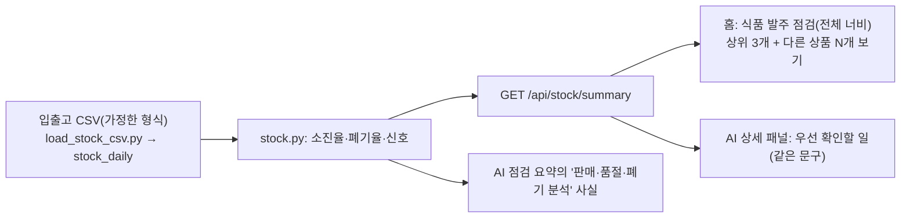

# 09. 식품 발주 점검 (입출고 소진율·폐기율·증량 검토 신호)

> **지금 상태:** 시연(가짜) 자료로 동작. 입출고 자료로 상품별 소진율·폐기율과 신호(증량 검토 / 폐기 점검 / 행사 비교 / 참고 / 자료 부족)를 계산해 홈 아래쪽 전체 너비 카드에 보여 주고, AI 점검 요약의 "점검 요약" 근거로도 쓴다. **입출고 파일 올리기 화면은 없다.**
> **관련 문서:** [stock.md](../stock.md), [stats-guide.md](../stats-guide.md) 6장 · **코드:** `backend/app/stock.py`, `stock_api.py`, `tools/make_stock_data.py`, `load_stock_csv.py`, `frontend/src/components/StockSignals.jsx`, `stockText.jsx`
> **커밋:** `abb4192`

## 변천 한눈에

| 버전 | 시점 | 방식 | 문제 | 고친 방법 |
|---|---|---|---|---|
| 초안 | 11-03 | 점주가 입출고 스키마(기초재고·입고·판매·폐기·행사·품절 시각 등)와 기능 아이디어를 제시. **실제 파일은 받을 수 없어 형식을 가정하고 시작**. "소진율, 폐기율, 신호를 먼저 보여 줘" | 실제 자료가 없다 | 가짜 자료(`make_stock_data.py`)로 계산·화면 완성, 화면에 시연용 표시 |
| v1 | 11-03 | 소진율 = 판매 ÷ (기초재고 + 입고), 폐기율 = 폐기 ÷ (기초재고 + 입고). 행사 없이 판매를 마친 최근 5회로 신호 | 검토 의견: 아래 2-1~2-4 | 검토 의견 반영 |
| UI v1 | 11-03 | 홈의 "집중 관리 식품군" 표 안에 상품별 소진율·신호를 함께 | 점주 의견: "집중 관리 식품군 표는 없애도 될 것 같다"(간편식사·즉석조리 판매 수량 표와 상품별 점검이 함께 있었음) | **집중 관리 식품군 표를 없애고** 식품 발주 점검만 전체 너비 카드로 |
| UI v2 | 11-03~04 | "판매 이유" 열, 기본 행에 근거가 여러 문장 | 점주 요청: 열 이름을 "확인할 이유"로, 기본 행에는 핵심 근거 한 문장만 | 권장 행동·비교 기록은 상세로, 확인할 상품은 3개까지 먼저 보임, 행 어디를 눌러도 상세(내부 버튼과 중복 실행 방지) |

## 1. 초안과 규칙

- 판매량이 늘었나가 아니라 **"준비한 상품이 반복해서 얼마나 팔리고 버려졌나"**를 본다. 신호 이름은 "증량 필요"가 아니라 **"증량 검토"**(판단이 아니라 점검 권유).
- 신호(모두 **제 판단의 검증 전 초기값**, `stock.PARAMS`):

| 신호 | 언제 | 화면의 말 |
|---|---|---|
| 증량 검토 | 소진율 90% 이상이 5회 중 4회, 일찍 품절 3회 이상, 폐기 평균 5% 이하 | "최근 5회 모두 일찍 품절됐어요" |
| 폐기 점검 | 폐기 20% 이상이 5회 중 3회 이상, 합산 소진율 70% 이하 | "최근 5회 중 5회 폐기가 20% 이상이었어요" |
| 행사 비교 | 소진율이 높은 날이 행사 때만 있음 | "행사 중에는 100%, 행사 없는 기간에는 82%였어요" |
| 참고 | 소진율은 높은데 일찍 품절은 없음 | "폐기 10%가 적절한지는 상품 이익과 비교해 보세요" |
| 자료 부족 | 행사 없는 날 5회 미만 또는 수량이 너무 적음 | 판단하지 않음 |

## 2. 검토 의견을 반영해 고친 점

1. **오늘 기록은 판단하지 않는다.** 아침에 본 오늘 기록은 판매가 끝나지 않아 소진율이 낮아 보일 뿐이다 → 판매 종료(22시) 전 기록은 "판매 중"으로만 표시.
2. **품절 시각이 없으면 낮춘다.** "판매 10개 / 가용 10개"만으로는 일찍 품절됐다고 말할 수 없다 → "증량 검토" 대신 "품절 확인"으로 낮추고 "품절 시각이 없어 다 팔렸는지로 추정했어요"를 적는다(`stockout_basis`).
3. **소진율은 기간 합산**(판매 합계 ÷ 가용 합계)이고 하루 소진율의 평균이 아니다. 이월 재고가 있으면 한계를 알리고, 재고 수량이 안 맞는 기록은 빼고 건수를 알린다. 분모 0은 계산하지 않는다.
4. **이름과 문구.** "비행사"가 내부 용어처럼 어색해 → "행사 없는 기간 / 행사 없이 판매를 마친 최근 5회". 배지는 짧게(증량 검토 / 폐기 점검 / 행사 비교 / 참고), 이유를 본문 첫 줄로. 공휴일·장날은 빼지 않았으므로 "평소"라고 쓰지 않는다.
5. **홈은 세 줄만.** 상품마다 확인할 이유 → 소진율·폐기율 → 다음 행동. 몇 회를 합산했는지·날짜별 수량·품절 시각·판정 기준은 "근거 보기" 안.
6. **AI 연결:** AI가 "점검 요약"을 쓰도록 이 분석 사실을 외부 정보보다 앞서는 근거로 전달한다(→ [08-ai-summary.md](08-ai-summary.md)).

## 3. 정확도 점검 (가짜 자료)

가짜 자료 200일을 3일마다 판단해 심어 둔 상황을 얼마나 맞히는지 쟀다(차트: `docs/handoff/images/4_소진율신호_정확도.png`).

- 심어 둔 상황은 대부분 맞혔다.
- **오탐:** "잘 맞는 상품"의 **약 9%에서 "증량 검토"가 잘못 나왔다.** 수요가 매일 흔들려 우연히 며칠 연달아 일찍 품절되기 때문이다.
- 그래서 "한 번 살펴보라"는 용도로만 쓰고 판매·폐기 수량을 함께 보여 준다. 기준값은 여러 지역·실제 자료로 조정해야 한다.

## 4. 현재 구성

## 5. 한계·남은 일
- 가짜 자료에서만 확인했고 신호의 기준값은 검증 전이다. 실제 입출고 자료를 받을 수 있는 경로가 아직 없다.
- **입출고 파일 올리기 화면 없음**(시연 DB에 도구로만 넣음), **"발주 변경 기록"**(증량·감량과 이유를 남기고 그 뒤 판매·폐기를 돌아보는 기능) 없음.
- 입고 묶음별 추적·소비기한 기준은 아직 아니다.
