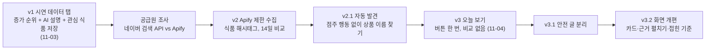
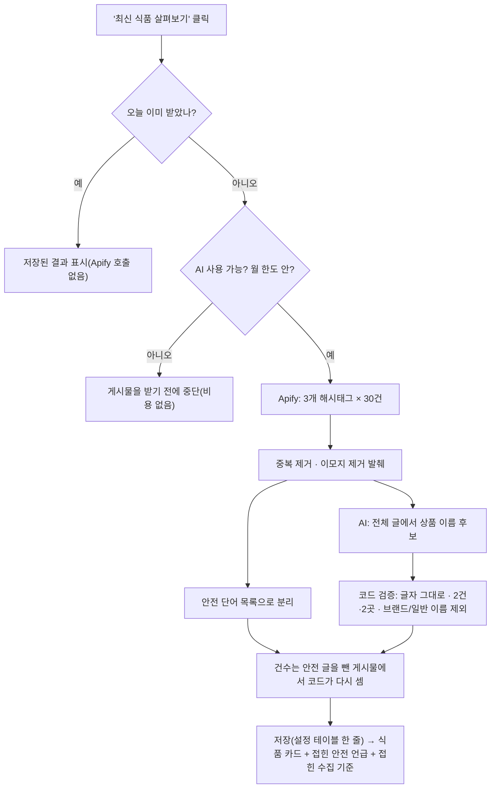

# 10. 요즘 뜨는 식품

> **지금 상태:** 버튼 **"최신 식품 살펴보기"** 한 번으로 인스타그램 편의점 신상 해시태그(`#편의점신상 #편의점디저트 #편의점간식`)의 최근 공개 게시물을 받아(Apify, 하루 1회·최대 90건·월 한도), 상품 이름별 **언급된 게시물 수와 작성 계정 수**를 보여 준다. 검색량도, 증가 추세도, 전체 인기 순위도 아니다. 회수·안전 글은 순위에서 빼고 접힌 영역에 "공식 확인 전"으로 따로 보인다.
> **관련 문서:** [trends.md](../trends.md)(설계·한계), [stats-guide.md](../stats-guide.md) 7·8장, [spec.md](../spec.md) · **코드:** 현재 방식 `backend/app/trend_today.py`, `trend_apify.py`(호출·한도), `trend_discover.py`(이름 후보 검증), `frontend/src/pages/Trends.jsx` / 옛 방식 `trend.py`, `trend_ai.py`, `trend_demo.py`
> **커밋:** `abb4192`(시연 데이터 버전), `2881c9c`(Apify·오늘 보기·안전 분리·UI 개편)

## 변천 한눈에

| 버전 | 방식 | 단점·문제 | 어떻게 바꿨나 |
|---|---|---|---|
| v1 (11-03) | 시연(가짜) 데이터로 **게시물 증가 순위** + AI 설명 + 근거 콘텐츠 + 관심 식품 저장. 최근 완료된 7일 vs 직전 7일 비교 | 실제 SNS 공급원이 없어 가짜 숫자뿐 | 공급원 조사 → v2 |
| v2 (11-03) | Apify로 **점주가 지정한 식품의 해시태그** 게시물을 모아 같은 집계 | ① 순위가 나오려면 **14일 연속 매일 수집**해야 함 ② 인기 해시태그는 해시태그당 상한에 거의 항상 걸려(`capped`) 하루를 온전히 못 봄 ③ 점주가 식품·해시태그를 골라야 함 | v2.1, v3 |
| v2.1 (11-03) | **점주 행동 없이**: 기본 해시태그에서 AI가 상품 이름 후보만 뽑고 코드가 검증 → 자동 추적 | 후보가 적다(23건에서 2개), 여전히 14일 연속·스케줄 없음·월 비용 | v3 |
| v3 (11-04) | **오늘 보기**: 버튼 한 번, 시계열·14일 비교·추적 목록 없음 | 표본이 작다(90건), "뜨는"·"검색량"으로 읽힐 위험 | 문구를 "최근 게시물에서 많이 언급된"으로, 표본 크기·기준을 화면에 표시 |
| v3.1 (11-04) | 회수·판매 중단 글은 순위에서 빼고 주의 영역으로 | 아래 2-5 | 아래 2-5 |
| v3.3 (11-04) | 안전 표시(`safety_posts`)와 옛 코드 정리 | 안전 글 분류가 단어 목록이라, 회수 소식이 주의 영역에 있는 상품이 식품 목록에도 그대로 남음 / 화면이 쓰지 않는 옛 코드(14일 비교·AI 설명·시연 공급·표 6개)가 남아 있음 | 아래 2-9 |
| v3.2 (11-04) | 식품 카드 먼저, 접힌 안전·수집 기준, 순위 번호 제거 | 안내문·경고가 식품 목록보다 먼저 읽힘, 순위 번호가 전체 인기 순위처럼 보임, 빨간 큰 영역이 공식 회수처럼 보임 | 아래 2-6 |

## 1. 초안 (v1)

- 점주가 최근 관심을 받는 식품을 발견하고, 관련 콘텐츠를 근거로 왜 화제인지 이해하도록 돕는 탭. 흐름: 관심이 늘어난 식품 → AI 설명 → 원본 콘텐츠 → 관심 식품 저장.
- 집계 규칙(코드가 계산, AI는 숫자를 만들지 않음): 언급량 = 중복 제거 게시물 수(같은 게시물의 여러 별칭 언급은 한 건, 같은 계정의 같은 글 한 건, 재게시·공식 발표는 세지 않음). 증가량 = 최근 − 직전, 증가율은 직전이 0이면 "새롭게 관측됨". **순위는 증가율이 아니라 증가량 순서**(2건→8건이 1등이 되지 않게). 게시물 10건·계정 5곳 미만은 순위에서 제외. 수집 못 한 날은 0건이 아니라 "모름".
- AI 설명: 확인된 계기(공식 발표에서 확인한 사실만) / 자주 등장하는 내용 / 해석("~일 수 있어요"). 인과 단정·근거 없는 연령·숫자·발주 권유·링크는 거절.
- 실제 공급원이 연결되기 전까지 **시연 데이터**로 화면·저장·집계·AI 설명을 완성했고, 화면에 "시연 데이터 · 지어낸 가짜 게시물이에요"를 표시했다.

## 2. 문제 발견과 수정 (순서대로)

### 2-1. 공급원 조사
- 프로젝트에 이미 연결된 것(카카오·공공데이터포털·소상공인·NEIS·SGIS·기상청)은 모두 식품·SNS 게시물이 **없다**.
- **네이버 검색 API(블로그·카페글)**: 사용 설명서에서 `total`이 기간과 무관한 전체 개수라 "최근 7일 게시물 수"로 쓸 수 없고, `sort=date`로 최신부터 `start` 1000까지(약 1,100건) 넘기며 직접 세어야 한다는 기술 한계를 확인했다. **저장·캐싱·AI 입력 등 약관은 읽지 못했다**(개발자센터 접속 불가, 보도로만 접함).
- 점주 결정: "다른 곳은 안 하고 Apify에서 인스타그램 게시물 크롤링으로 트렌드 검색만 제한적으로 해 보자."

### 2-2. Apify 제한 수집(v2)의 설계와 안전장치
- 공식 Actor `apify/instagram-hashtag-scraper`(해시태그의 **최신 게시물**, 날짜 범위 조건 없음). 가격: 무료 플랜 1,000건에 2.60달러($5 무료 크레딧 ≈ 2,000건).
- 제한: 해시태그당 30건, 한 번 실행 0.25달러(`maxTotalChargeUsd`), 월 1,500건. 호출 전 `--dry-run`으로 계획·어림 비용을 보고 `--yes`가 있어야만 실제 호출. 토큰은 `Authorization: Bearer`로만 보내고 오류 메시지·로그에 담지 않는다.
- 저장은 최소: 게시물 번호, 링크, 게시 시각, 캡션 앞 200자, **계정을 해시한 값**(이름·이미지·좋아요는 저장하지 않음). 30일 지나면 삭제.
- **위험을 먼저 적었다:** Instagram(Meta) 이용약관은 확인하지 못했다. 자동 수집이 약관 위반일 수 있고 책임은 사용자에게 있다고 보고 진행.

### 2-3. 실제로 돌려 보니 (점주가 `.env`에 토큰을 넣은 뒤)
- 첫 시험: 결과 20건(18건 저장), 어제는 상한에 걸려 `capped`.
- **한계가 현실로 확인됨:** 인기 해시태그는 하루 게시물이 상한(30건)보다 많아 거의 항상 `capped` → 비교가 성립하지 않는다. 순위가 나오려면 같은 식품·해시태그·상한으로 **14일 연속** 매일 실행해야 하고, 추적 해시태그 집합이 바뀌면 14일 동안 순위가 막힌다.
- 점주 요청 "최대한 점주는 아무 행동도 하지 않았으면 좋겠다" → **자동 발견(v2.1):** 기본 해시태그 게시물에서 AI가 **상품 이름 후보만** 뽑고, 코드가 ① 이름이 근거 게시물 캡션에 글자 그대로 있어야 하고(띄어쓰기 무시) ② 서로 다른 게시물 2건·계정 2곳 이상 ③ 브랜드·일반 이름(도시락, 젤리 등) 제외 ④ 별칭도 캡션에 실제 있는 것만으로 검사한 뒤 추적 목록에 올린다. 발견용 게시물은 순위에 세지 않는다. 결과: 23건 게시물에서 후보 2개(피자설기 3건·계정 3곳, 요즘 블루베리 그릭요거트 모찌롤 2건·계정 2곳).
- 매일 자동 실행(스케줄)과 월 비용 상한은 점주가 **"자동 수집은 보류"**로 답했다. 하루 8개 해시태그 × 30건이면 한 달 약 19달러가 든다.

### 2-4. 실수: 의도하지 않은 실제 호출 (비용 사고)
- **사건:** 명령줄 도구를 시험하다 실제 Apify가 호출돼 60건(약 0.16달러)이 나갔다. 점주에게 바로 알렸다.
- **원인:** `post=apify_post`가 함수 정의 때 묶여 시험에서 바꿔 끼워도 소용없었고, 시험에서 `APIFY_TOKEN`을 지우지 않았다.
- **수정:** `post=None`으로 두고 호출할 때 `post or apify_post`로 찾게 했고, 시험 설정이 `APIFY_*` 환경 변수를 모두 지우며, 해당 시험은 `delenv("APIFY_TOKEN")`을 명시했다. 이 일까지 포함해 오늘 보기를 만들기 전 실제 사용은 약 117건(약 0.3달러 어림).

### 2-5. v3: 오늘 보기와 표현의 정직성
- **점주 제안:** "트렌드를 오늘 많이 검색된 편의점 식품으로 할까? 시계열로 매일 수집할 필요 없게 수집 버튼을 누르면 오늘자 트렌드가 뜨는 식으로." → 점주가 "14일 비교 화면은 없어도 될 것 같아"로 확정.
- **바로잡은 점:** Apify로 얻는 것은 게시물이라 **검색량이 아니고**, 지난주 비교가 없으니 **"뜨는(증가)"도 주장할 수 없다** → 화면 문구를 "최근 게시물에서 많이 언급된 편의점 식품"으로 하고 "검색량도, 늘고 있다는 뜻도 아니에요"를 적었다.
- 동작: 3개 해시태그 × 30건을 한 번 받아 AI가 이름 후보를 뽑고, **건수는 코드가 전체 게시물에서 다시 센다**(AI가 말한 건수는 쓰지 않음). 서로 다른 게시물 2건·계정 2곳 이상만 표시. **하루 1회**(오늘 이미 받았으면 저장된 결과), 월 한도·실행 비용 상한, **AI가 꺼져 있으면 게시물을 받기 전에 막아** 비용이 들지 않게 했다. 저장은 설정 테이블 한 줄(새 테이블 없음 → Supabase 마이그레이션 불필요).
- **표본을 늘릴 수 있나(질문):** 설정 세 곳과 코드 상수 한 곳이 함께 막는다 — 해시태그당 30건, 실행 비용 상한 0.25달러(건당 약 2.6달러/1000건이라 약 96건이 한계), 월 1,500건, AI에 보내는 글 상한 `MAX_POSTS_SENT`=100. 점주가 일단 현재 설정으로 실험하기로 해 **바꾸지 않았다.**

### 2-6. 한 게시물에 상품이 여러 개
- **문제:** "신상 5종 먹어봄" 같은 글이 5개 상품에 각각 +1이 되어 총정리 글이 순위를 같이 올린다. 캡션을 앞 200자만 저장해 목록 뒤쪽 상품은 아예 못 센다.
- **제안:** "단독 언급 / 함께 언급"으로 나눠 표시. **점주가 안 하기로 했고**(아래 안전 분리만 선택) 한계로 문서에 적어 두었다.

### 2-7. 회수 뉴스 글 (v3.1)
- **발견:** 점주가 붙여 준 "GS25 품절 대란 '피스타치오 찹쌀떡', 대장균군 검출로 판매 중단" 같은 뉴스성 글은 상품 이름이 있다는 이유만으로 "언급"으로 세어진다. 당시 실제 결과에서 "한정선 피스타치오 찹쌀떡 11건"이 1위였다(11건이 모두 회수 글이었는지는 확인하지 못했다). 회수 소식은 인기 신호가 아니라 정반대이고 점주에게는 오히려 가장 중요한 정보다.
- **제안과 결정:** 부정/긍정을 색으로 표현하는 안은, 긍정 분위기를 AI가 추정해야 하고 코드로 맞는지 확인할 수 없어 **회수·안전만** 다루기로 했다(점주: "회수·안전 글은 순위에서 빼고 빨간 경고로 별도 표시, 이 정도만").
- **구현:** 고정 단어 목록(회수, 판매중단, 부적합, 검출, 리콜, 이물질, 식중독, 대장균 등, 띄어쓰기 무시. "폐기"·"환불"은 폐기 할인 같은 일반 글에 쓰여서 뺌)으로 AI가 아니라 **코드가** 가려낸다.
- **후속 문제 1 — 상품 이름 미확인:** 안전 글을 AI에게 보여 주지 않았더니 주의 영역의 모든 글이 "상품 이름 미확인"이었다 → **이름 찾기는 전체 글로 하고 건수는 안전 글을 뺀 것만** 센다.
- **후속 문제 2 — 옛 저장 결과로 화면이 비어 보임:** 화면을 개편한 뒤 개편 전 형식(게시일이 없는)으로 저장된 오늘 결과를 읽다가 오류로 화면 전체가 빈 것처럼 보였다 → 옛 형식도 읽게 고치고 저장분은 보존했다.

### 2-8. v3.2 화면 개편 (점주 사양)
- **요구:** 식품 목록이 긴 안내문과 경고보다 먼저 읽히게, 표본 게시물 수를 전체 인기 순위나 검색량처럼 표현하지 않게, 근거는 펼쳐서, 미확인 안전 언급과 공식 확인을 구분.
- **반영:** 제목·한 줄 설명 → 갱신 상태(마지막 갱신·수집 게시물 수·"인스타그램 실제 수집") → 식품 카드(2열/모바일 1열, **순위 번호 제거**, 수집 게시물·작성 계정, "근거 게시물 N건 보기"로 발췌·게시일·원본 링크) → 접힌 "안전 관련 언급 · 확인 필요 게시물 N건"(**빨강 대신 절제된 앰버**, 공식 회수처럼 보이지 않게) → 접힌 "수집 기준과 한계 보기". 수집 완료는 비활성 버튼이 아니라 "✓ 오늘 수집 완료 · 다음 수집은 내일" 문구.
- **일부러 안 한 것:** 카드별 AI 요약 문장(상품별 AI 설명을 만들지 않으므로 영역 생략), 이미지·썸네일(사용 권한 미확인), "공식 확인" 표시(공식 출처 연결 없음).

### 2-9. 안전 표시와 옛 코드 정리 (v3.3, 점주 요청)
- **안전 표시:** 점검에서 같은 상품이 주의 영역(안전 글 10건)과 식품 목록(2건)에 동시에 있는 것을 발견했다. 같은 상품 이름이 들어 있는 안전 글이 있으면 식품 카드에 앰버 안내를 붙인다(`safety_posts`). 건수를 빼거나 순서를 바꾸지 않고, 표시용으로만 센다. 단어 목록에 걸리지 않는 관련 글은 이 표시에도 잡히지 않는다.
- **옛 코드 정리:** 14일 비교 집계(`trend.py`), AI 설명(`trend_ai.py`), 시연 데이터 공급(`trend_demo.py`), `/api/trends` 옛 주소 5개, 14일 수집·자동 추적 도구와 시험, 모델 6개, 화면의 옛 CSS를 지웠다. `trend_apify.py`는 호출·한도·월 사용량·결과 변환만, `trend_discover.py`는 이름 후보 검증만 남았다. 환경 변수 `APIFY_MAX_HASHTAGS`는 필요 없어졌다.
- **표 6개와 마이그레이션:** 0012는 점주가 아직 적용하지 않았지만 이미 적용된 곳이 있을 수 있어 **고치지 않고**, 표를 지우는 **0013을 추가**했다(표가 없으면 건너뛰고, 되돌리면 0012의 표를 다시 만든다). 시험이 "마이그레이션이 만든 표 = 모델 표"를 비교하는데, 모델을 먼저 지우고 0012가 표를 만들어 이 시험이 깨지면서 이 방식을 택했다.
- 서버 시험은 455개에서 412개가 되었다(지운 옛 방식 시험과 즉석식품 시험이 빠지고, 안전 표시·0013·이름 검증 시험이 더해짐).

## 3. 현재 흐름

## 4. 알려진 한계·남은 일

- **Instagram(Meta) 이용약관은 확인하지 못했다.** 네이버 검색 API 약관도 읽지 못했다.
- 표본이 작다(최대 90건). 순서는 이 표본 안에서만 의미가 있고 편의점 전체 인기가 아니다.
- **안전 분류의 빈틈(2026-11-04 확인):** 단어가 없는 관련 글은 안전 글이 아니라 식품 목록에 남는다(같은 상품 이름이 들어 있는 안전 글이 있으면 v3.3의 안전 표시가 붙지만, 단어에 걸리지 않은 글은 거기에도 잡히지 않는다). 실제로 같은 날 안전 글 10건이 분리됐는데(주의 영역에는 최대 5건만 보임), 같은 상품("한정선 피스타치오 찹쌀떡")이 식품 목록에도 2건으로 남아 있었다. 이 점검 뒤 식품 카드에 "안전 관련 언급 있음" 표시를 붙였다(2-9).
- AI가 상품이 아닌 이름을 뽑을 수 있다. 브랜드·일반 이름 목록(`BRANDS`/`GENERIC`)은 부족하면 늘려야 한다.
- 이름 후보가 하나도 없으면 그날은 빈 결과로 저장되어 내일까지 다시 받을 수 없다.
- 식약처 등 공식 회수 정보 연결은 이용 조건을 확인하지 않아 하지 않았다.
- 매일 자동 실행·월 비용 상한은 정하지 않았다(보류).
