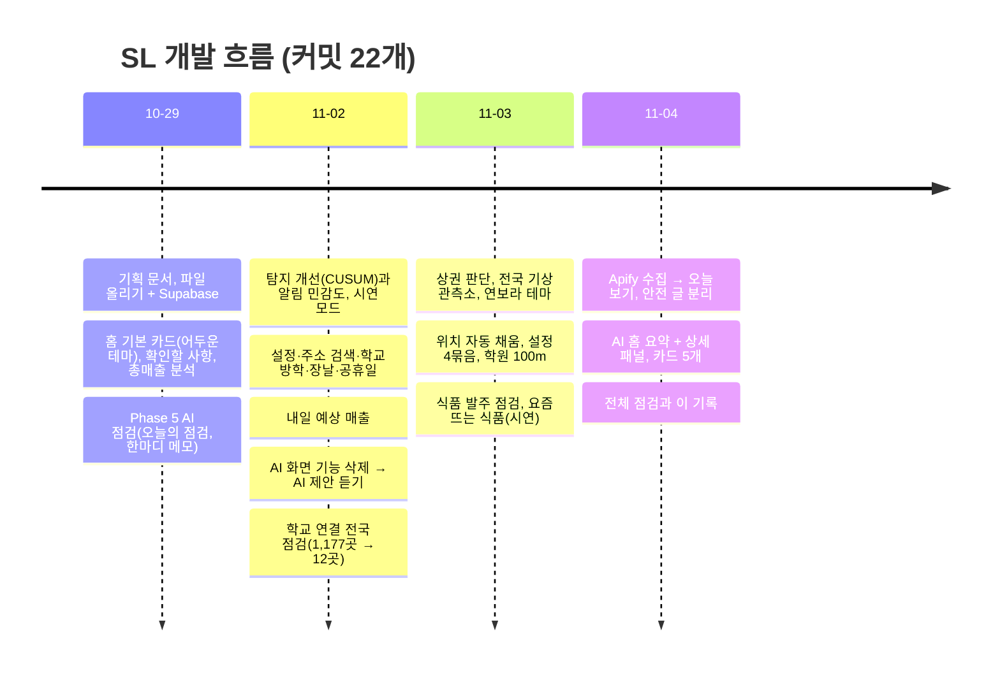

# 기능별 변천 기록

각 기능이 **처음에 어떻게 설계됐고, 어떤 단점이 있어서, 어떤 과정을 거쳐 지금 방식이 됐는지**를 기능별로 적은 폴더입니다. 지금의 동작 설명은 [spec.md](../spec.md)와 각 설계 문서에, 이 폴더에는 "왜 이렇게 바뀌었나"가 있습니다.

## 어떻게 썼나 (근거와 한계)

- 근거: git 커밋 메시지, `docs/handoff/`의 날짜별 작업 정리, 설계·명세 문서, 개발 중 점주와 주고받은 결정.
- **기록에 이유가 남아 있지 않은 것은 "기록에 이유가 없음"으로 적었습니다.** 추측으로 이유를 만들어 쓰지 않았습니다.
- 점주가 직접 한 말은 따옴표로, 제 판단으로 정한 기준값은 "제 판단"(검증 전 초기값)으로 표시했습니다.
- 숫자(시험 개수, 재현율, 비용 등)는 그 시점에 문서·실행으로 확인한 값입니다. 실제 매출 숫자는 넣지 않았습니다.

## 기능 목록

| # | 기능 | 지금 상태 | 한 줄 요약 |
|---|---|---|---|
| 01 | [로그인과 파일 올리기](01-login-upload.md) | 동작 | 비밀번호 1개, CSV 올리기. 개발용 SQLite → Supabase |
| 02 | [홈 화면과 디자인](02-home-design.md) | 동작 | 어두운 카드형 → 밝은 연보라 테마, 1단 → 60/40 2단 + 식품 발주 점검 |
| 03 | [확인할 사항(이상 탐지)](03-attention-detection.md) | 동작 | 하루 비교만 → 로그·요일 효과·CUSUM. "정상" → "운영 상황 기록" |
| 04 | [총매출 분석](04-sales-analysis.md) | 동작 | 통계 용어 많던 화면 → 3단계 화면 |
| 05 | [내일 예상 매출](05-forecast.md) | 동작(첫 버전) | 모형이 평소 기준보다 나을 때만 사용, 범위만 표시 |
| 06 | [설정과 자동 채우기](06-settings-autofill.md) | 동작 | 직접 입력 → 공식 자료 가져오기 → 위치만 정하면 자동 |
| 07 | [상권 판단](07-area-judgement.md) | 동작 | 학원 500m·5곳 → 100m·3곳, 직장인·주거·교통 판단 추가 |
| 08 | [AI 점검 요약](08-ai-summary.md) | 동작 | AI 점검 → AI 제안 → 홈 짧은 요약 + 상세 패널 |
| 09 | [식품 발주 점검](09-stock-signals.md) | 동작(가짜 자료) | 소진율·폐기율·증량 검토 신호, 오탐 약 9% |
| 10 | [요즘 뜨는 식품](10-trends.md) | 동작(오늘 보기) | 시연 증가 순위 → Apify 14일 비교 → 버튼 한 번 + 안전 글 분리 |
| 11 | [시연 모드와 랩 데이터](11-demo-lab.md) | 동작 | 가짜 자료로 화면·탐지 평가 |
| 99 | [전체 점검 기록(2026-11-04)](99-audit-2026-11-04.md) | — | 동작 점검, 문서 어긋남, 폴더 정리 결과 |

## 전체 흐름 (날짜순)

## 여러 기능에 걸친 공통 교훈

1. **코드가 계산하고 AI는 정리만 한다.** 숫자·순위·신호를 AI가 만들면 지어낼 수 있어서, AI의 글은 코드가 검사한다(숫자·근거 번호·단정 표현). 의미까지는 검사하지 못한다는 한계는 모든 AI 기능에 남아 있다.
2. **규칙 검사는 용도마다 달라야 한다.** 점검용 검사가 제안의 자연스러운 이유 설명을 막은 일(08), 사실 그대로의 "100%"가 확신 표현으로 걸린 일(08)이 같은 뿌리다.
3. **시연(가짜) 값이 실제 동작에 섞이면 안 된다.** 시연 DB의 장날(06), 가짜 숫자의 표시(11).
4. **모르는 것은 0이 아니라 "모름"으로.** 수집하지 못한 날(10), 파일을 올리지 않은 날(04), 추정으로 본 품절(09).
5. **단정하지 않는다.** "정상·문제없음"을 쓰지 않고(03, 04), "뜨는"·"검색량"이라고 부르지 않으며(10), 외부 정보로 짐작한 것은 판매 효과가 확인되지 않았다고 밝힌다(08).
6. **한 곳의 버그는 한 지역 전체일 수 있다.** 교육청 이름 변경으로 전남 학교 1,135곳을 못 찾은 일(06).
7. **돈이 드는 호출은 막을 장치를 먼저.** `--dry-run`/`--yes`, 실행 비용 상한, 월 한도, AI가 꺼져 있으면 호출 전에 중단(10). 그래도 시험이 실제 호출을 낸 사고가 있었다(10-2-4).
8. **기준값은 모두 제 판단이다.** 학원 100m·3곳, 소진율 90%, 게시물 2건·계정 2곳, 50km 등은 통계로 구한 값이 아니라 초기값이며, 실제 자료로 조정해야 한다.

## 이 폴더에 파일을 더하는 법
새 기능이나 큰 변경이 생기면 `NN-이름.md`를 만들고 (1) 지금 상태 요약 (2) 변천 한눈에 표 (3) 초안 (4) 문제와 수정 (5) 현재 흐름 (6) 한계 순서로 씁니다. 이유가 기록에 없으면 없다고 적고, 위 목록과 이 README의 타임라인에도 한 줄 더합니다.
