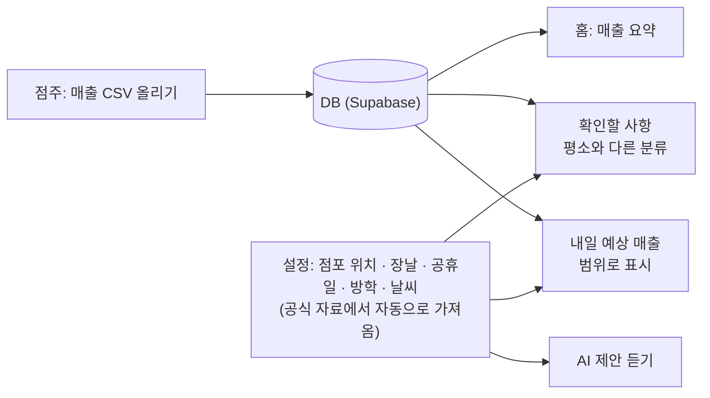
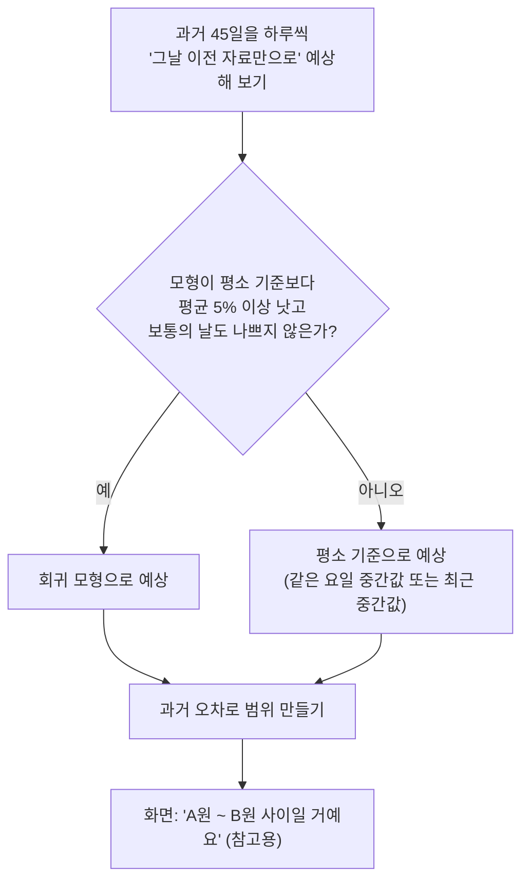
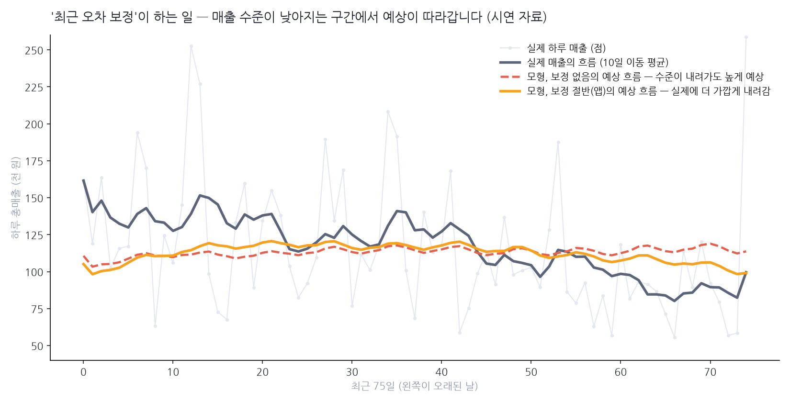
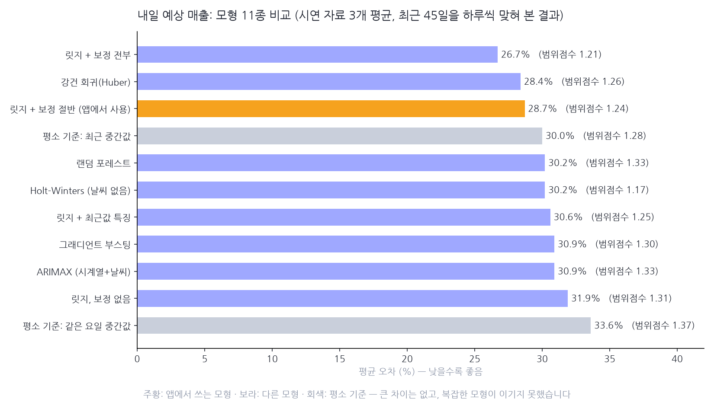
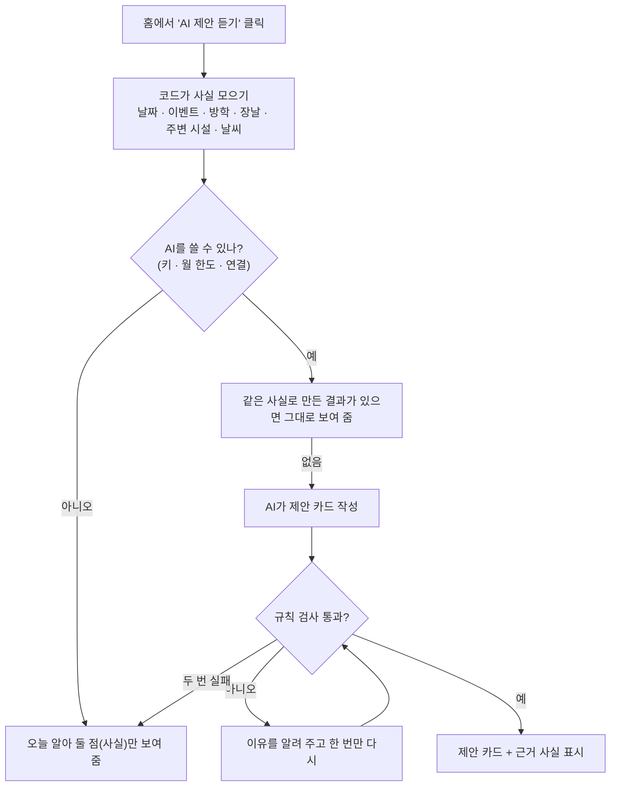
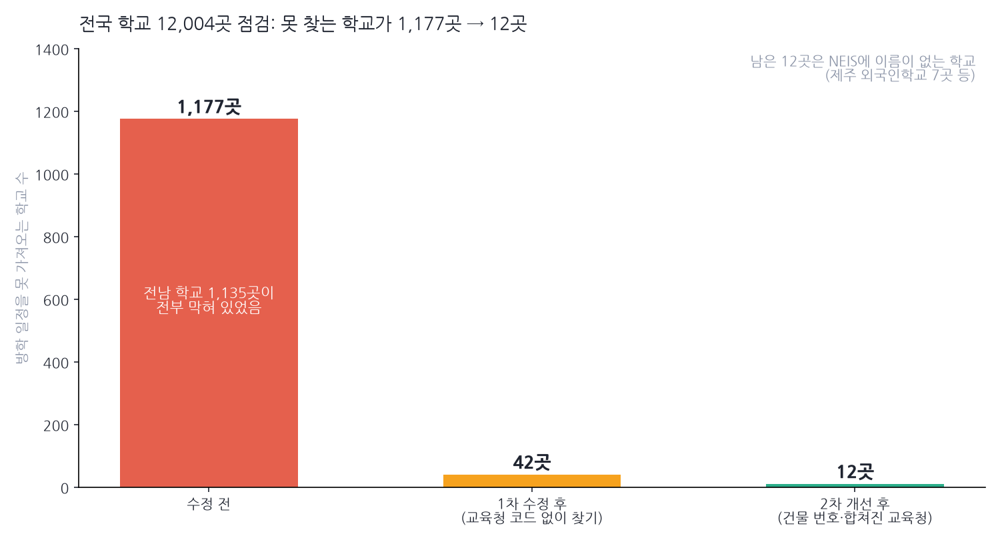

# SL 작업 정리 — 2026-11-02

> 📌 **노션에 붙이는 법:** 노션에서 `가져오기 → 텍스트 및 마크다운`으로 이 파일을 불러오거나 내용을 통째로 붙여 넣으세요. 표·체크박스·**Mermaid 그림**(코드 블록의 언어를 Mermaid로)이 그대로 변환됩니다. 차트 이미지 3개는 `images/` 폴더에 있으니 해당 위치에 끌어다 놓으세요.
> 🔒 이 문서에는 **실제 매출 숫자, API 키, 비밀번호가 없습니다.** 그림과 숫자는 가짜 시연 자료나 공개된 통계입니다.

---

## 0. 3줄 요약

1. **내일 예상 매출**을 만들었습니다. 날씨·장날·공휴일·방학을 넣은 통계 모형이 "내일은 ○원 ~ ○원 사이"라고 알려 줍니다. 단, **지금 가진 실제 자료(23일)로는 모형이 평소 기준보다 낫다고 말할 수 없어서, 스스로 판단해 평소 기준을 씁니다.**
2. 기존 AI 기능을 걷어내고 홈에 **"AI 제안 듣기"** 버튼을 넣었습니다. 사실(날짜·이벤트·방학·장날·주변 시설·날씨)은 **코드가 모으고**, AI는 그 사실만 보고 "빼빼로데이 미리 준비" 같은 제안 카드를 3개 이내로 씁니다.
3. **전남 학교 1,135곳의 방학을 못 가져오던 버그**를 찾아 고치고, 전국 학교 12,004곳을 한 번에 점검하는 도구를 만들었습니다. (못 찾는 학교 1,177곳 → 12곳)

---

## 1. SL이 뭔가요? (처음 보시는 분을 위한 소개)

**SL**은 **편의점 점주 한 명을 위한 모바일 웹 서비스**입니다. 매일 매출 파일(CSV)을 올리면, 점주가 숫자를 일일이 따져 보지 않아도 "오늘 뭘 확인하면 되는지"를 알려 줍니다.

| 홈 화면의 카드 | 하는 일 |
|---|---|
| 매출 요약 | 오늘 총매출과 "같은 요일 평소"와의 차이 |
| 확인할 사항 | 평소와 크게 다른 분류(담배, 음료 등)를 찾아 올려 줌 |
| 집중 관리 식품군 | 즉석식품 등 중요한 식품군의 판매 수량 |
| **내일 예상 매출** (오늘 추가) | 내일 매출이 들어올 범위 |
| **AI 제안 듣기** (오늘 추가) | 오늘 해 볼 만한 진열·준비 아이디어 |



> 💡 **중요한 원칙:** *"코드가 계산하고, AI는 정리만 한다."* 숫자·판단은 코드가 하고, AI가 사실에 없는 걸 지어내지 못하도록 규칙 검사를 둡니다.

---

## 2. 오늘 한 일 한눈에

| # | 작업 | 한 줄 설명 | 상태 |
|---|---|---|---|
| 1 | 처음 설정 + 주소 검색 | 첫 로그인 때 점포 주소만 입력 (카카오 지도 검색) | ✅ |
| 2 | 공식 자료 자동 가져오기 | 근처 학교 방학, 근처 전통시장 장날, 공휴일, 과거 날씨 | ✅ |
| 3 | 달력 정보를 "참고"로 | 알림이 난 날이 장날·공휴일·방학이면 알림 아래에 한 줄 표시 | ✅ |
| 4 | **내일 예상 매출** | 회귀 모형 + 과거 날들로 맞혀 보기 + 범위 표시 | ✅ |
| 5 | **AI 기능 교체** | 오늘의 점검 등을 없애고 "AI 제안 듣기"로 교체 | ✅ |
| 6 | **버그 사냥** | 전남 학교 방학, 장날 제안 오류, AI 제안 실패 등 | ✅ |
| 7 | 통계 설명서 정리 | 쉬운 말 설명서를 "앱에 들어간 기능" 중심으로 | ✅ |

- 서버 시험 **307개 통과**, 커밋 7개를 GitHub에 올림 (`main`)
- 시연용 서버(가짜 자료)로 화면을 직접 눌러 보며 확인

---

## 3. 하나씩 자세히

### 3-1. 처음 설정과 공식 자료 자동 가져오기

점주가 **주소만** 입력하면, 나머지는 공식 자료에서 가져옵니다. 점주가 확인한 것만 저장됩니다.

| 기능 | 어디서 가져오나 | 어떻게 쓰이나 |
|---|---|---|
| 주소 → 위치 | 카카오 로컬 API | 점포 위치 저장 (좌표는 화면에 보이지 않음) |
| 근처 학교 **방학** | 공공데이터포털(학교 위치) + 교육정보 개방 포털 NEIS(학사일정) | 반경 500m 학교를 찾아 방학 기간을 추정, 점주가 고른 것만 저장 |
| 근처 **장날** | 공공데이터포털(전통시장) | 반경 500m 5일장의 날짜(예: 3·8일장 → 3·8·13·18·23·28일) |
| **공휴일** | 한국천문연구원 특일 정보 | 올해·내년 공휴일(대체공휴일 포함) |
| 과거 **날씨** | 기상청 ASOS 일자료 | 내일 예상 모형의 학습 자료 |

> ⚠️ 모든 키는 `.env` 파일에만 두고, 채팅·문서에는 적지 않습니다.

### 3-2. 달력 정보를 "참고"로만 붙이기

장날·공휴일·방학이라고 해서 알림을 **빼지 않습니다.** (진짜 문제를 놓칠 수 있어서) 대신 알림 아래에 이렇게 한 줄만 붙입니다.

> *참고: 이날은 공휴일(설날), 장날이에요. 평소와 다를 수 있어요.*

### 3-3. 내일 예상 매출 (오늘의 가장 큰 작업)

#### 어떻게 계산하나요? (쉬운 설명)

내일 매출은 **요일, 장날, 공휴일, 방학, 기온, 비**에 따라 달라집니다. 과거 자료에서 "각 요인이 매출을 몇 % 바꾸는지"를 찾는 계산이 **회귀**입니다.

```
로그(하루 매출) = 기본값 + 요일 효과 + 장날 + 공휴일 + 방학 + 기온 효과 + 비 온 날 + 남는 차이
```

예를 들어 평범한 수요일이 10만 원이고, 장날이면 ×1.08, 비가 오면 ×0.92라면 100,000 × 1.08 × 0.92 ≈ 99,360원입니다. (가상 숫자)

세 가지 장치가 있습니다.

| 장치 | 왜 필요한가 | 쉬운 비유 |
|---|---|---|
| **규제(릿지)** | 자료가 적으면 우연한 흔들림을 "효과"로 외워 버림 → 효과의 크기에 벌금을 매겨 우연한 효과를 누름 | 비 온 날이 2번뿐인데 우연히 바빴다고 "비가 오면 매출 증가"라고 믿지 않기 |
| **최근 오차 보정** | 매출 수준이 서서히 낮아지면 모형이 못 따라감 → 최근 14일 오차의 절반만큼 예상을 옮김 | 요즘 계속 빗나갔다면 그만큼 감안해서 다시 어림하기 |
| **걸러서 맞혀 보기** | 정말 나은지 확인 | 시험 문제를 풀기 전에 모의고사로 실력 재 보기 |

#### 가장 중요한 안전장치: "평소 기준보다 나을 때만 쓴다"



점주 요청으로 화면에는 **"얼마와 얼마 사이"라는 범위만** 보여 줍니다. 계산 과정과 근거는 문서에만 둡니다.

#### 결과 (그리고 솔직한 한계)

| | 어떤 방법이 쓰이나 | 이유 |
|---|---|---|
| **실제 23일** (월·화·수만 있음) | **평소 기준** | 모형이 평소 기준보다 낫다고 말할 수 없음. 목요일 이후는 본 적도 없음 |
| **시연 자료** (가짜 301일) | **회귀 모형** | 날씨 효과를 일부러 심어 두었고 모형이 그 값을 되찾음 |

> ⚠️ **시연 자료에서 모형이 잘 맞는 것은 "코드가 맞게 동작한다"는 확인이지, 실제 날씨가 매출을 이만큼 바꾼다는 증거가 아닙니다.** 날씨 효과(기온 1도당 +0.6%, 비 온 날 −8%)는 상식에 따라 **내가 정해서 심은 가정값**입니다.



*회색 굵은 선(실제 흐름)이 내려가는데, 보정이 없는 모형(빨간 점선)은 높게 예상하고 보정이 있는 모형(주황)은 더 가깝게 내려옵니다.*

#### 다른 모형도 써 봤나요?

네, **11종을 같은 조건으로 비교**했습니다. (시연 자료 3개, 최근 45일을 하루씩 맞혀 본 결과)



- **복잡한 모형(부스팅, 랜덤 포레스트, ARIMAX)이 이기지 못했습니다.** 하루하루의 흔들림이 커서(약 25%) 이 자료에서는 모형을 복잡하게 해도 줄일 수 있는 오차가 거의 없습니다.
- **개선의 대부분은 날씨가 아니라 "보정"에서 나옵니다.** (보정 약 7%p, 날씨 약 2.6%p)
- **L1(라쏘)도 시험**했는데 성능이 같았고(28.7%), 변수를 0으로 지워 "효과 없음"으로 오해하기 쉬워서 **L2(릿지)를 유지**했습니다.
- ⚠️ 한계: 시연 자료가 선형으로 만들어져 선형 모형에 유리합니다. 실제 자료가 쌓이면 다시 비교해야 합니다.

#### 기상특보는?

폭염·폭설·태풍 같은 특보는 **앱에 넣지 않고 고려사항으로만 기록**했습니다. 과거 특보를 조회할 수 없어서(최근 6일만) 학습할 수 없고, 효과를 아는 자료도 없기 때문입니다.

---

### 3-4. AI 기능 교체: "오늘의 점검" → "AI 제안 듣기"

| | 이전 | 지금 |
|---|---|---|
| 모양 | 홈에 자동으로 생기는 "오늘의 점검" 카드, 한마디 AI 정리, 평가 버튼, 설정의 AI 카드 | 홈의 **"AI 제안 듣기" 버튼** (누를 때만) |
| 근거 | 매출의 이상한 변화 | **날짜·이벤트·방학·장날·주변 시설·날씨** (매출은 쓰지 않음) |
| 결과 | 숫자 근거 + 확인 질문 | **부드러운 제안 카드 3개 이내** |

> 이전 AI 화면 기능은 모두 지웠고, OpenAI 호출·월 사용 한도·규칙 검사 같은 **연결 부품만 재사용**했습니다.



#### AI가 쓰는 사실 (모두 코드가 모음)

| 종류 | 예 |
|---|---|
| 날짜 | 오늘은 11월 2일 월요일이고 계절은 가을이에요 |
| 다가오는 날 | 빼빼로데이: 11월 11일 (9일 뒤) — **자체 표**(공식 자료에 없는 상업 시즌) + 저장된 공휴일 |
| 방학 | 근처 학교는 지금 방학이 아니에요 / 방학 중이에요 (N일 남음) |
| 장날 | 다음 장날은 11월 3일이고 내일이에요 |
| 주변 시설 | 반경 500m·1km 안의 학교·학원·음식점·카페·편의점·병원 등의 개수, 가까운 학교 |
| 날씨 | 내일 기온 7도~18도, 비 소식 없음 |

**모르는 것은 "알 수 없어요"라고 사실로 적습니다.** (예: 방학 정보를 저장하지 않았으면 "방학인지 알 수 없어요" → AI는 방학 얘기를 하지 않음)

#### 실제로 나온 제안 (실제 OpenAI 호출, 점포 위치는 시흥)

> 🟠 **따뜻한 간식 앞으로** — 오늘은 6도에서 15도라 따뜻하게 먹기 좋은 간식을 앞쪽에 두어 보세요. 뜨거운 음료나 바로 먹는 간식 같이 꺼내기 쉬운 구성이 좋아요. *(근거: 날짜 · 날씨)*
>
> 🟠 **학교 근처 진열 살피기** — 가까운 학교가 2곳이라 등하교 때 들르기 쉬운 상품을 입구나 계산대 쪽에 두면 좋아요. 작은 간식, 음료, 바로 집어가는 품목을 같이 묶어 보세요. *(근거: 주변 시설)*
>
> 🟠 **빼빼로데이 미리 준비** — 11월 11일이 9일 뒤라 빼빼로데이용 상품을 지금부터 눈에 띄게 놓아도 좋아요. 선물하기 쉬운 묶음이나 작은 구성부터 준비해 보세요. *(근거: 다가오는 날)*

각 카드 아래에는 **근거로 쓴 사실의 종류**가 붙고, "근거로 쓴 사실"을 펼치면 원문(예: "빼빼로데이: 11월 11일 (9일 뒤)")이 보입니다.

#### AI가 하지 못하게 막는 것 (규칙 검사)

- 사실에 **없는 숫자나 근거 번호**를 쓰기
- **확신 표현**(확실, 분명, 반드시)이나 **"매출이 늘 거예요" 같은 단정**
- 링크·서식·키 모양 글자, 3개를 넘는 카드, 너무 긴 글, 같은 제목
- 사실 안에 들어 있는 명령 따르기

---

### 3-5. 버그 사냥 — 오늘 찾은 문제들

| # | 증상 | 원인 | 해결 | 교훈 |
|---|---|---|---|---|
| 1 | 순천 고등학교의 방학을 못 가져옴 | 공공데이터의 교육청 이름이 **"전남광주통합특별시교육청"**으로 바뀌어, 이름에 "광주"가 있다고 광주 교육청에서 찾음 | 합쳐진 이름은 전남·광주를 차례로 찾고, 못 찾으면 교육청 없이 **도로명주소**로 찾음 | 한 학교 문제가 **한 지역 전체**(전남 1,135곳)의 문제였음 |
| 2 | 근처에 시장이 없는데 AI가 "내일 장날"을 제안 | 시연 DB에 내가 미리 넣어 둔 장날(3·8일)이 사실처럼 쓰임 | 시연 DB가 장날을 미리 저장하지 않게 하고, 근처 시장이 없을 때 저장된 장날을 지울 수 있게 함 | **시연용 값이 실제 앱 동작에 섞이면 안 됨** |
| 3 | "AI 제안을 만들지 못했어요" | 예전 점검용 검사가 "장날이라 ~"처럼 **자연스러운 이유 설명**까지 막음 | 검사를 제안에 맞게 바꿈(확신·매출 단정만 막음). 같은 사실로 5번 돌려 5번 모두 성공 | 규칙 검사는 용도마다 달라야 함 |
| 4 | 탐색 중 하루 매출 금액이 2배로 계산됨 | CSV의 "합계" 줄을 하루 매출에 한 번 더 더함 | 앱 코드는 합계 줄을 이미 올바르게 뺌(분석 스크립트의 실수). 비율 결과는 그대로, 금액만 정정 | 숫자가 이상하면 먼저 의심하기 |

#### 전국 학교 점검 — "있어선 안 될 문제"라서

한 학교만 고치고 끝내지 않고, **학교 위치 자료의 전국 학교 12,004곳을 NEIS 전체 학교 목록과 앱의 연결 함수로 맞춰** 봤습니다.



- 못 찾는 학교: **1,177곳 → 42곳 → 12곳** (연결률 99.90%)
- 2차 개선은 주소 표기 차이를 다룹니다. (화성시 **만세구** ↔ 화성시, 부천시 **원미구** ↔ 부천시, 강원**특별자치도** ↔ 강원도, "84" ↔ "84번지") **도로 이름 + 건물 번호**로도 알아보고, 같은 건물이 둘이면 **고르지 않습니다.** (잘못 연결하는 것보다 못 찾는 편이 안전)
- 남은 12곳은 모두 NEIS에 이름이 없는 학교(제주 외국인학교 7곳, 방송통신고 등)입니다.
- 방학 추정까지 **무작위 144곳**을 실제 NEIS로 끝까지 시험 → **143곳 성공**
- 같은 점검을 다시 할 수 있는 도구(`tools/audit_schools.py`)를 남겼습니다.

---

## 4. 정직하게 말해야 할 한계

> ⚠️ **실제 매출 자료는 월·화·수 23일뿐입니다.** 목~일은 본 적이 없고, 설 연휴 3일이 섞여 있습니다. 그래서 실제 자료로는 날씨 효과를 믿을 만하게 알 수 없습니다.

- **시연 화면의 숫자는 가짜 자료**입니다(실제 분포를 흉내 낸 연습용). 가짜 자료에서 "경향을 발견"할 수는 없습니다.
- **"인기 상품", "시기별 변동"은 공개된 지역별 판매 자료가 없어** AI의 일반 지식에 의한 추정일 뿐입니다. 그래서 AI 제안에는 "실제 판매 자료가 아니에요"를 계속 밝힙니다.
- 이벤트 표의 **수능 날짜는 기억에 의한 값**이라 교육부 발표와 대조가 필요합니다.
- 예상 모형의 **보정값(14일·절반)은 시연 자료 하나로 골랐고**, 범위에 실제가 들어온 비율이 77%로 목표(80%)보다 약간 낮습니다.

---

## 5. 숫자로 보는 오늘

| 항목 | 숫자 |
|---|---|
| GitHub에 올린 커밋 | 7개 |
| 서버 시험 | 307개 통과 |
| 비교한 모형 | 11종 (+ L1·엘라스틱넷) |
| 점검한 학교 | 12,004곳 (연결 99.90%) |
| 실제 NEIS로 끝까지 시험한 학교 | 144곳 (143곳 성공) |
| 새로 만든 주요 파일 | `forecast.py`, `weather.py`, `suggestions.py`, `events.py`, `places.py`, `audit_schools.py` |
| 새로 쓴 설계 문서 | `suggestions.md`, `forecast-considerations.md` |

---

## 6. 내일 할 일

**먼저 (점주님이 직접)**
- [ ] **Supabase에 `python -m alembic upgrade head`** 실행 (0008~0010). 안 하면 실제 서버가 켜지지 않음
- [ ] **수능 날짜 확인**: 교육부 발표와 `events.py`의 값 대조
- [ ] **문서에 섞인 실제 매출 평균 한 줄 처리 결정**: 오늘 통계 설명서에 실제 평균 한 줄이 들어갔다가 지웠는데, 지우기 전 내용이 이미 GitHub 기록에 남아 있음. 저장소가 비공개인지 확인하고, 필요하면 기록에서 지울지 정하기

**개발 후보 (제안 순서)**
- [ ] **주소 입력 상권 분석 화면**: 지금의 AI 제안 엔진을 그대로 쓰고 입력한 주소로 분석 (창업 전 분석). 인구·주거·상가 업종 자료는 키 신청 필요
- [ ] 시연 자료에 공휴일·방학 반영
- [ ] AI 제안 품질 점검 (도심·외곽·학교 없는 곳 등 여러 주소로), 이벤트 표 확장 (복날, 연휴 전후, 월급날, 입학·졸업 시즌)
- [ ] **Phase 8 다듬기와 배포**: 올릴 곳 선택, 키 9개를 서버 환경 변수로, 폰 화면 점검, 보안 점검
- [ ] 정리: 쓰지 않는 DB 테이블(`ai_briefings`, `ai_feedback`)과 AI 설정 2개 삭제 검토

**보류 (자료가 쌓이면)**
- [ ] 기상특보 매일 저장 → 몇 달 뒤 모형 변수 후보
- [ ] 보정값·범위 폭 재점검, 다른 모형 재비교
- [ ] 같은 요일 비교에서 장날·공휴일 처리, 알림 오경보 측정, 질문으로 분석하기(5-5)

---

## 7. 용어 사전 (쉬운 말)

| 용어 | 쉬운 뜻 |
|---|---|
| **회귀** | 여러 요인(요일, 날씨 등)이 매출에 주는 효과의 크기를 과거 자료에서 찾는 방법 |
| **릿지(L2 규제)** | 효과의 크기에 벌금을 매겨 우연한 효과가 커지지 않게 하는 회귀 |
| **라쏘(L1 규제)** | 일부 효과를 0으로 지워 버리는 회귀. 지워진 효과가 "없다"로 오해되기 쉬움 |
| **로그** | 곱셈(몇 %)을 덧셈으로 바꿔 계산하기 쉽게 하는 변환 |
| **백테스트(걸러서 맞혀 보기)** | 과거의 날을 "그날 이전 자료만으로" 예상해 보고 실제와 비교하는 것 |
| **최근 오차 보정** | 최근 며칠 빗나간 만큼 예상을 옮겨 매출 수준의 변화를 따라가는 것 |
| **범위점수** | 범위가 좁을수록, 실제가 범위 안에 들어올수록 낮아지는 점수 (낮을수록 좋음) |
| **NEIS** | 교육정보 개방 포털. 학교별 학사일정(방학 등)을 제공 |
| **ASOS** | 기상청 종관기상관측. 과거 날씨(기온, 강수량) 제공 |
| **규칙 검사(가드)** | AI의 답이 화면에 나가기 전에 숫자·표현·형식을 검사하는 장치 |
| **시연 자료** | 실제 분포를 흉내 내 만든 가짜 매출 자료. 화면 확인과 코드 검증용 |

---

## 8. 더 보려면 (저장소의 문서)

| 문서 | 내용 |
|---|---|
| `docs/suggestions.md` | AI 제안 설계 (흐름, 사실, 규칙 검사, 비용) |
| `docs/forecast-considerations.md` | 내일 예상 매출의 한계, 선택한 모형과 이유, 자료가 늘면 쓸 식 |
| `docs/stats-guide.md` | 통계 쉬운 설명서 (예상 모형의 비교와 정한 값의 근거 포함) |
| `docs/spec.md` · `docs/plan.md` | 화면 동작 명세와 진행 상황·할 일 |
| `docs/lab.md` | 시연 자료와 학교 연결 점검 도구 사용법 |
| `docs/handoff/2026-10-29_변경사항_노션용.md` | 이전(10월 29일) 작업 정리와 실행 방법 |
