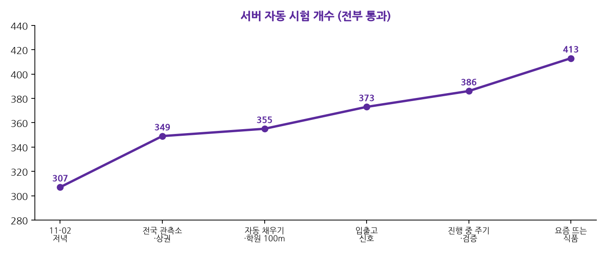
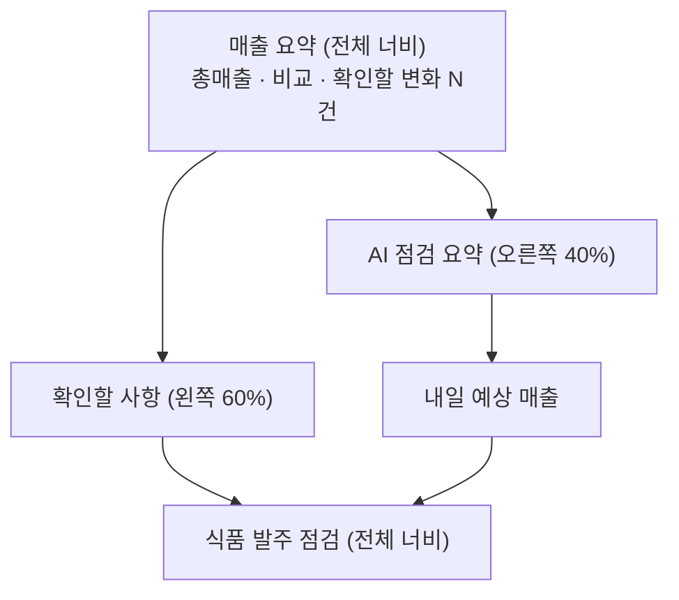
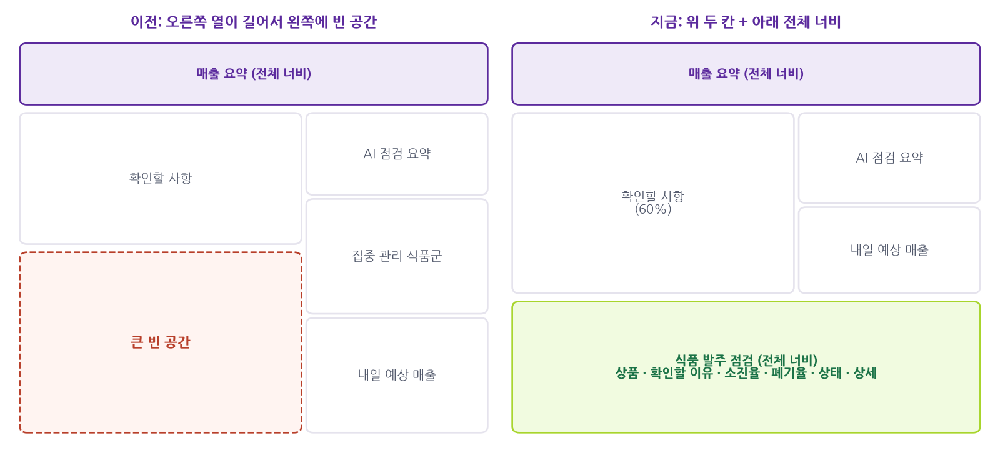
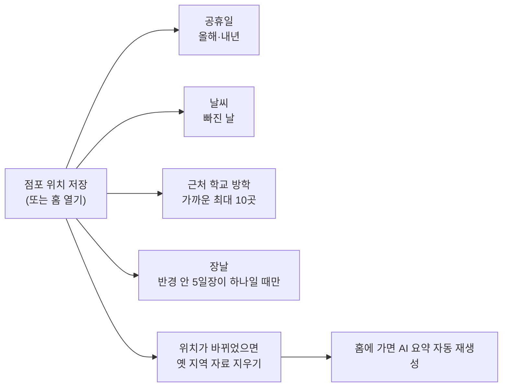
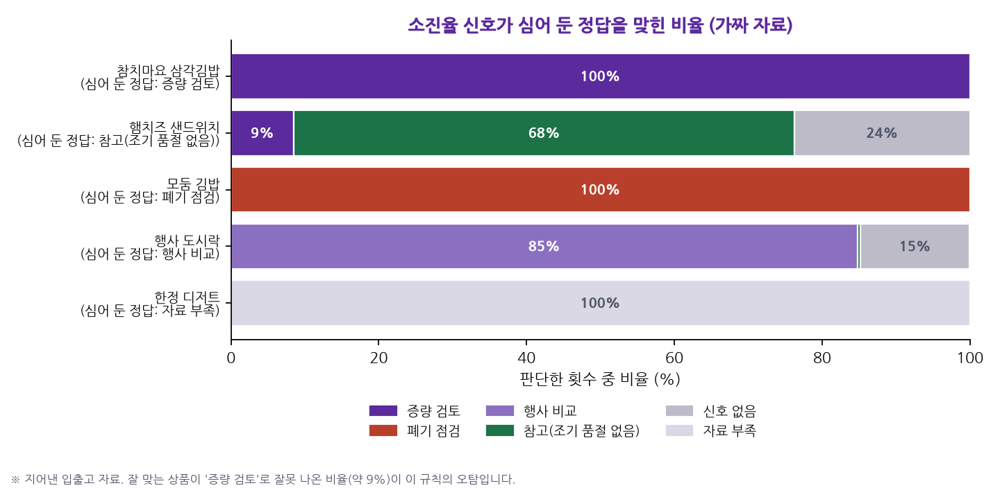
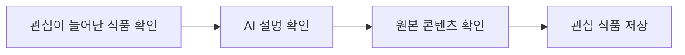
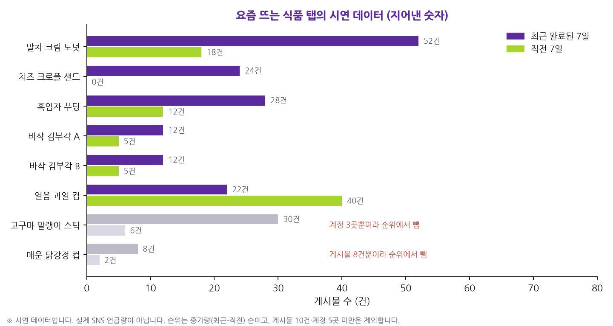

# SL 작업 정리 — 2026-11-03

> 📌 **노션에 붙이는 법:** 노션에서 `가져오기 → 텍스트 및 마크다운`으로 이 파일을 불러오거나 내용을 통째로 붙여 넣으세요. 표·체크박스·**Mermaid 그림**(코드 블록의 언어를 Mermaid로)이 그대로 변환됩니다. 차트 이미지 4개는 `images/` 폴더(`4_`~`7_`)에 있으니 해당 위치에 끌어다 놓으세요.
> 🔒 이 문서에는 **실제 매출 숫자, API 키, 비밀번호가 없습니다.** 그림과 숫자는 가짜 시연 자료입니다.

---

## 0. 3줄 요약

1. **홈 화면을 점검 목록처럼** 다시 짰습니다. 위에 매출 요약, 가운데에 `확인할 사항`(60%)과 `AI 점검 요약`·`내일 예상 매출`(40%), 아래에 전체 너비 **식품 발주 점검**이 옵니다. 설정도 4묶음(점포 정보·분석 데이터·알림·계정)으로 줄였습니다.
2. **점포 위치만 정하면 나머지는 자동**이 되도록 했습니다. 공휴일·날씨·근처 학교 방학·장날을 알아서 채우고, 위치를 바꾸면 옛 지역 자료를 지운 뒤 새로 채우고 AI 요약도 다시 만듭니다.
3. 새 기능 두 가지를 **가짜(시연) 자료로** 만들었습니다. ① 입출고 자료로 상품별 **소진율·폐기율·증량 검토 신호**(식품 발주 점검), ② **요즘 뜨는 식품** 탭. 실제 자료를 받을 수 있는 공급원이 아직 없기 때문입니다.

---

## 1. 오늘 한 일 한눈에

| # | 작업 | 한 줄 설명 | 상태 |
|---|---|---|---|
| 1 | 상권 판단 | 상가정보·동네 인구를 연결해 학생·직장인·주거·교통 상권을 코드가 판단 | ✅ |
| 2 | 전국 기상 관측소 | 수도권뿐이던 관측소를 전국 97곳으로, 너무 먼 곳(50km 초과)은 가져오지 않음 | ✅ |
| 3 | 디자인 개편 | 밝은 연보라·보라·라임 테마, 컴퓨터용 위쪽 메뉴·2단 배치, 둥근 편의점 그림 | ✅ |
| 4 | 사용 편의 점검 | 파일 올리기·기록 목록·분류 상세·설정의 버튼과 문구 다듬기 | ✅ |
| 5 | 홈 화면 개선 | 매출 요약 띠, 확인할 사항 정리, `AI 점검 요약`(핵심 한 가지부터) | ✅ |
| 6 | 자동 채우기 | 공휴일·날씨·학교 방학·장날 자동, 위치 변경 시 정리, AI 요약 자동 재생성 | ✅ |
| 7 | 설정 4묶음 | 왼쪽 메뉴 + 오른쪽 한 묶음, `설정이 필요한 항목 N개` 요약 | ✅ |
| 8 | 학원 반경 100m | 먼 학원은 편의점 손님과 거리가 멀다고 보고 점포 바로 앞 100m만 셈 | ✅ |
| 9 | **식품 발주 점검** | 입출고 자료로 소진율·폐기율·신호 (가짜 자료) | ✅ 시연 |
| 10 | AI 분석 카드 | AI가 판매·품절·폐기 분석을 먼저, 외부 정보 아이디어는 따로 | ✅ |
| 11 | **요즘 뜨는 식품** 탭 | 게시물 증가 순위 + AI 설명 + 관심 식품 저장 (시연 데이터) | ✅ 시연 |

- 서버 시험 **307개 → 413개**, 전부 통과 (오늘 커밋 8개, GitHub에는 7099f92까지 올림, 마지막 커밋 abb4192는 **아직 로컬에만** 있음)
- 시연용 서버(가짜 자료)로 화면을 직접 눌러 보며 확인했습니다.

---

## 2. 하나씩 자세히

### 2-1. 상권 판단과 전국 관측소

- 소상공인 **상가정보**(경쟁 편의점·업종 분포)와 **SGIS 동네 인구**를 AI에게 줄 사실로 연결했습니다. 학교는 반경 500m, **학원은 점포 바로 앞 100m**에서 3곳 이상이면 학생 상권으로 봅니다(기준 수는 제 판단).
- "일하는 사람 ÷ 사는 사람" 비율로 직장인·주거 동네를, 지하철역 수로 교통 영향을 말합니다. 모두 **"일반적인 추정"**이라고 밝히고, 점포 매출로 확인한 것처럼 쓰지 않습니다.
- 같은 사실을 근거로 한 AI 카드가 겹치면 앞의 것만 남기도록 했습니다.
- 기상 관측소가 수도권만 있어서 충남 보령은 122km 떨어진 수원 날씨를 쓰던 문제를 **전국 97곳**으로 고쳤고, 50km보다 멀면 날씨를 가져오지 않고 "관측소가 멀어요"로 알립니다.

### 2-2. 디자인과 사용 편의

- 밝은 연보라 배경에 보라(메뉴·링크·AI 강조), 라임(주요 버튼) 테마. 컴퓨터에서는 위쪽 메뉴와 넓은 2단 배치, 휴대폰은 아래 메뉴.
- 둥근 편의점 그림과 마스코트는 **상표·로고 없이** 직접 그렸습니다.
- 업로드·기록·설정의 버튼 이름과 순서, 되묻기, 접었다 펴기를 다듬고 컴퓨터·휴대폰에서 눌러 보며 점검했습니다.

### 2-3. 홈 화면

- 카드 사이 간격은 24px로 통일했고, 카드 높이 고정·음수 마진·카드 안 스크롤은 쓰지 않았습니다.
- 컴퓨터와 휴대폰에서 읽는 순서가 달라서 CSS로 순서를 바꾸지 않고, **화면 폭에 따라 카드를 그리는 순서 자체를 바꿔** Tab 키 이동 순서가 눈에 보이는 순서와 같게 했습니다.
- `AI 점검 요약`은 **제안 2~3개**만 번호로 보여 주고 근거는 접어 둡니다. 위쪽은 **점검 요약**(우리 점포 입출고 기록으로 계산), 아래쪽은 **추가 운영 아이디어**(날짜·날씨 같은 외부 정보)로 나누고, 두 종류를 한 카드에 섞으면 검사에서 거절합니다.

### 2-4. 위치만 정하면 나머지는 자동

- 키가 없거나 연결이 안 돼도 홈과 저장은 그대로 동작하고, 그 항목만 설정에서 `확인 필요`로 보입니다.
- 위치가 바뀌면 옛 지역의 공식 방학·장날·다른 관측소의 날씨를 지우고 새 위치로 다시 채웁니다. **점주가 직접 입력한 방학은 지우지 않습니다.** 같은 위치를 다시 저장하면 아무것도 지우지 않습니다.
- 시연 서버에서 보령→시흥→보령으로 옮겨 실제로 확인했습니다(시흥장현초 방학이 자동으로 들어오고, 보령으로 돌아오면 비워짐).
- **제가 정한 기준:** 학교는 반경 안 가까운 최대 10곳 **전부**(점주가 고르던 단계가 없어짐), 장날은 5일장이 딱 하나일 때만 자동.

### 2-5. 식품 발주 점검 (입출고 자료, 가짜)

입출고 자료(기초재고·입고·판매·폐기·행사·품절 시각)를 **가정하고** 만든 기능입니다. 실제로 받을 수 있는 파일이 아직 없습니다.

- **소진율** = 판매 ÷ (기초재고 + 입고), **폐기율** = 폐기 ÷ (기초재고 + 입고). "판매량이 늘었나"가 아니라 **"준비한 상품이 반복해서 얼마나 팔리고 버려졌나"**를 봅니다.
- 행사 없이 판매를 마친 최근 5회를 보고 신호를 냅니다. 신호 이름은 "증량 필요"가 아니라 **"증량 검토"**입니다.

| 신호 | 언제 | 화면에 나오는 말 |
|---|---|---|
| 증량 검토 | 소진율 90% 이상이 5회 중 4회, 일찍 품절 3회 이상, 폐기 평균 5% 이하 | "최근 5회 모두 일찍 품절됐어요" |
| 폐기 점검 | 폐기 20% 이상이 5회 중 3회 이상, 합산 소진율 70% 이하 | "최근 5회 중 5회 폐기가 20% 이상이었어요" |
| 행사 비교 | 소진율이 높은 날이 행사 때만 있음 | "행사 중에는 100%, 행사 없는 기간에는 82%였어요" |
| 참고 | 소진율은 높은데 일찍 품절은 없음 | "폐기 10%가 적절한지는 상품 이익과 비교해 보세요" |
| 자료 부족 | 행사 없는 날이 5회 미만이거나 수량이 너무 적음 | (판단하지 않음) |

**검토 의견을 반영해 고친 점**
- 아침에 본 **오늘 기록은 판단하지 않습니다**(판매가 끝나지 않아 소진율이 낮아 보일 뿐). "판매 중"으로만 표시합니다.
- **품절 시각이 없으면** "다 팔렸는지"로 추정할 수밖에 없어서 "증량 검토" 대신 "품절 확인"으로 낮추고 그 사실을 적습니다. 판매 10개/가용 10개만으로는 일찍 품절됐다고 말할 수 없기 때문입니다.
- 소진율은 **기간 합산**(판매 합계 ÷ 가용 합계)이고 하루 소진율의 평균이 아닙니다. 이월 재고가 있으면 한계를 알리고, 재고 수량이 서로 안 맞는 기록은 뺍니다.
- 홈에는 상품마다 **이유 한 줄**만 보이고, 날짜별 수량·판정 기준은 `상세 보기` 안에 있습니다. 확인할 상품은 3개까지만 먼저 보입니다. "비행사"는 어색해서 "행사 없는 기간"으로 바꿨습니다.

> ⚠️ **오탐이 있습니다.** 가짜 자료 200일을 3일마다 판단해 보니, 심어 둔 상황은 대부분 맞혔지만 **"잘 맞는 상품"의 약 9%에서 "증량 검토"가 잘못 나왔습니다.** 수요가 매일 흔들려 우연히 며칠 연달아 일찍 품절되기 때문입니다. 그래서 "한 번 살펴보라"는 용도이고 판매·폐기 수량을 같이 보여 줍니다. 기준값은 모두 **제 판단의 검증 전 초기값**입니다.

### 2-6. 요즘 뜨는 식품 탭 (시연 데이터)

**데이터 공급원 확인 결과**

| 구분 | 내용 |
|---|---|
| 지금 가져올 수 있는 것 | 프로젝트에 연결된 공공·지도·기상 자료뿐 (식품·SNS 게시물은 **없음**) |
| 계정·승인·계약이 필요할 수 있는 것 | 검색 관심도, 영상·블로그 검색, 인스타그램·틱톡 공식 API — **아직 선택·공식 문서 확인 안 함** |
| 확보할 수 없는 것 | 인스타그램·틱톡 전체의 실시간 언급량, 비공개 데이터, 작성자 나이·성별 |

그래서 **실제 공급원이 연결되기 전까지는 시연 데이터**로 화면·저장·집계·AI 설명을 완성했습니다. 시연 데이터 공급 코드는 실제 수집 코드와 **다른 파일**에 있고, 화면 맨 위에 "시연 데이터 · 지어낸 가짜 게시물이에요"가 점선 배지로 붙습니다.

**집계 규칙 (코드가 계산, AI는 숫자를 만들지 않음)**
- 언급량 = **중복 제거 게시물 수**. 같은 게시물의 여러 번(여러 별칭) 언급은 한 건, 같은 계정의 같은 글은 한 건, 재게시와 공식 발표는 세지 않음.
- **최근 완료된 7일 vs 직전 7일**(한국 시간). 증가량 = 최근 − 직전, 증가율 = 증가량 ÷ 직전. 직전이 0건이면 증가율 없이 **"새롭게 관측됨"**.
- 관심 증가순은 **증가율이 아니라 증가량 순서**입니다(2건→8건 같은 작은 숫자가 1등이 되지 않게). 게시물 10건·작성 계정 5곳 미만은 순위에서 빼고 이유를 보여 줍니다(검증 전 초기값).
- **수집하지 못한 날은 0건이 아니라 "모름"**입니다. 수집 못 한 날이 있거나 수집 범위가 다르면 증가 순위를 보류하고 이유를 알립니다.
- 같은 이름의 다른 브랜드 상품은 임의로 합치지 않습니다.

**AI 설명**은 `확인된 계기`(공식 발표에서 확인한 사실만) / `자주 등장하는 내용`(게시물에서 반복된 주제) / `해석`("~일 수 있어요")으로 나눕니다. 인과 단정("~ 때문에")·근거에 없는 연령 표현·근거에 없는 숫자·발주를 권하는 말·링크는 검사에서 거절하고, 쓸 만한 글이 3건 미만이면 AI를 부르지 않고 "설명할 자료가 부족해요"를 보여 줍니다. 한 번 만든 설명은 저장해 다시 만들지 않고, 근거가 바뀌면 "오래됐을 수 있어요"를 알립니다. **이 탭은 우리 점포의 상품·매출과 연결돼 있지 않고 발주 수량을 권하지 않습니다.**

---

## 3. 안전 원칙 (바뀌지 않은 것)

> 💡 **"코드가 계산하고, AI는 정리만 한다."** 숫자·순위·신호는 코드가 만들고, AI는 그 결과를 풀어 쓰기만 합니다. 숫자·근거 번호·단정 표현은 코드가 검사합니다.

- 실제 매출 숫자는 저장소·문서·시험에 넣지 않습니다. 시연 자료는 모두 지어낸 것이고 화면에 표시됩니다.
- API 키는 `backend/.env`에만 있고 화면·문서·로그에 나오지 않습니다.
- 가짜 데이터를 실제 매출·SNS 언급량처럼 보이게 하지 않습니다(`시연용 상품 데이터`, `시연 데이터` 표시).

---

## 4. 알아 둘 한계

- **기준값은 모두 제 판단의 검증 전 초기값입니다.** (학원 100m 안 3곳, 소진율 90%·5회 중 4회, 게시물 10건·계정 5곳, 일하는 사람÷사는 사람 비율 등) 여러 지역·실제 자료로 조정해야 합니다.
- 입출고 신호는 가짜 자료에서만 확인했고, 잘 맞는 상품에도 약 9%는 "증량 검토"가 잘못 나옵니다.
- AI 문장은 숫자·번호·단정 표현은 검사하지만 **의미까지 검사하지는 못합니다.** 분석 카드에 사실에 없는 설명(시간대·원인)이 섞인 적이 있어 지시문으로 막았지만 완전하지 않습니다.
- 요즘 뜨는 식품은 **수집한 게시물 기준**이고 실제 SNS 전체 언급량이 아닙니다. 게시물이 늘었다고 실제 판매가 느는 것도 아닙니다.
- 입출고 파일을 올리는 화면은 없습니다(시연 DB에 도구로만 넣음).

---

## 5. 내가 해야 할 일 / 정할 일

- [ ] **Supabase에 `alembic upgrade head` 실행** — 이제 `0008~0012`까지 (설정, 일정·장날, 날씨, 입출고, 요즘 뜨는 식품). 실행 전에는 실제 서버가 시작되지 않습니다.
- [ ] 마지막 커밋(abb4192)을 GitHub에 **푸시할지** 정하기
- [ ] 요즘 뜨는 식품의 **실제 공급원**을 고르고 공식 문서로 이용 조건 확인하기
- [ ] 다음 기능 고르기: `발주 변경 기록`(증량·감량 기록과 그 뒤 판매·폐기 돌아보기), 입출고 파일 올리기 화면
- [ ] 예전에 푸시한 기록(a2567d9)에 실제 평균 금액 문장이 남아 있음 — 기록을 정리할지, 저장소 공개 여부 확인
- [ ] 설정의 `점포 정보 → 주소 변경`은 원래 시험용 임시 칸이었는데 정식 기능이 됨 — 이대로 둘지

---

## 6. 오늘의 커밋

| 시각 | 커밋 | 내용 |
|---|---|---|
| 10:12 | 4a267b0 | AI 제안에 학생 상권·상가정보·동네 인구·상권 성격, 설정에 위치 다시 고르기 |
| 10:52 | f7ba03e | 홈 요약 띠·2단 배치, 위쪽 메뉴, 연보라·보라·라임 테마 |
| 12:09 | fd8b376 | 전국 기상 관측소 97곳과 50km 안전장치 |
| 12:09 | 316485f | 둥근 편의점 그림·마스코트, 하단 메뉴 가림 수정 |
| 15:18 | 7099f92 | 홈·설정 개편, 위치 기반 자동 채우기, 학원 100m |
| 17:13 | abb4192 | 입출고 소진율·발주 점검, 홈 레이아웃 재구성, 요즘 뜨는 식품 (**로컬만**) |

(10:12와 10:52의 문서·설치 파일 커밋 2개는 생략)
